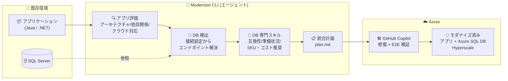

# Azure SQL Database / GitHub Copilot: Modernize CLI によるアプリケーションとデータベースの AI 統合モダナイゼーション (Public Preview)

**リリース日**: 2026-11-18

**サービス**: Azure SQL Database / GitHub Copilot app modernization

**機能**: AI-powered application and database modernization with Modernize CLI

**ステータス**: In preview (Public Preview)

[このアップデートのインフォグラフィックを見る](https://takech9203.github.io/azure-news-summary/20261118-modernize-cli-app-database.html)

## 概要

Microsoft Ignite 2026 で、アプリケーションとデータベースのモダナイゼーションを 1 つのつながったエージェント型ジャーニーとして実行する「Modernize CLI」の新機能がパブリックプレビューとして発表されました。Modernize CLI は、アプリケーションのアーキテクチャ・依存関係・クラウド対応状況を評価しながら、そのアプリケーションが依存するデータベースを検出し、互換性・移行準備状況・移行先の推奨を判断するデータベース専門スキルを呼び出します。

アプリケーションコードとデータレイヤーの両方を対象とした統合的なモダナイゼーション計画が生成され、その後 GitHub Copilot を使ってアプリケーションとデータベースの変更を修復 (remediation) し、ワークロード全体を Azure 上でエンドツーエンドに検証できます。従来は別々の取り組みだったアプリとデータベースのモダナイゼーションが、単一の統合された体験に変わります。

今回のプレビューでデータベース側に追加されたのは SQL Server の移行準備評価 (アセスメント) です。アプリケーションの構成ファイルから SQL Server エンドポイントを自動検出し、Azure SQL Database Hyperscale への移行準備状況を評価します。評価は「互換性 (compatibility)」「評価可能性 (assessability)」「サイジング (sizing)」「価格 (pricing)」の 4 つの観点を統合し、移行ブロッカーの優先順位付け、推奨コンピュート/ストレージ (SKU 推奨)、前提付きコスト見積もりを出力します。

**アップデート前の課題**

- アプリケーションのモダナイゼーション (フレームワーク更新、クラウド対応) とデータベースの移行評価は、別々のツール・別々の工程で実施する必要があり、知見やコンテキストが分断されていた
- アプリが依存するデータベースの検出、互換性評価、移行先選定、コスト見積もりを個別に行うため、数百のアプリと SQL Server インスタンスを抱える大規模環境では「何が移行可能で、何がブロックされ、何を先にやるべきか」の意思決定が困難だった
- 評価結果がレポートで完結し、その後の修復・移行作業に直接つながらなかった

**アップデート後の改善**

- アプリ評価の過程で依存するデータベース (SQL Server) を自動検出し、データベース専門スキルを呼び出して互換性・移行準備・移行先推奨まで 1 つのワークフローで実施
- アプリケーションコードとデータレイヤーにまたがる統合モダナイゼーション計画 (plan.md) を生成し、人がレビュー・編集してから実行できる
- 評価結果が次のエージェント操作のコンテキストとなり、GitHub Copilot による修復と Azure 上でのエンドツーエンド検証まで接続される

## アーキテクチャ図



Modernize CLI がアプリケーションを評価する過程で依存する SQL Server を検出し、データベース専門スキルで互換性・サイジング・コストを評価、アプリとデータ層を統合した計画を生成します。計画は GitHub Copilot による修復と Azure 上での検証につながります。

## サービスアップデートの詳細

### 主要機能

1. **アプリケーションとデータベースの統合アセスメント**
   - アプリのコード・依存関係・構成を分析し、古いフレームワークバージョン、非推奨 API、クラウド互換性の問題、移行機会を特定
   - Full analysis 実行時に、アプリの接続設定や参照される環境変数から SQL Server エンドポイントを自動解決し、検出された複数のエンドポイントすべてを評価

2. **SQL Server → Azure SQL Database Hyperscale の移行準備評価**
   - 互換性・評価可能性・サイジング・価格の 4 観点を統合した評価
   - 出力: ターゲット適合性、優先順位付きブロッカー、推奨コンピュート/ストレージ、前提付きコスト見積もり
   - Azure SQL Managed Instance と SQL Server on Azure VM は、ワークロード要件に応じた代替移行パスとして引き続き選択可能

3. **スキルファーストのエージェントモデル**
   - SQL 向けジャーニーは Assess → Recommend → Plan → Migrate → Validate で構成され、エージェントが SQL 専門スキル (準備状況とブロッカー、ターゲット/SKU ガイダンス、前提条件と修復、BACPAC や LRS 等による移行、移行後検証) を呼び出せる設計
   - 評価結果はレポートで終わらず、次のエージェント操作のコンテキストになる

4. **既存パフォーマンスデータからの SKU 推奨**
   - `skuRecommendation=true` と `performanceDataPath` を指定することで、収集済みのパフォーマンス CSV に基づく SKU 推奨を準備状況評価と併せて取得可能 (新規のパフォーマンスデータ収集は行わない)

5. **大規模環境 (エステート) 対応**
   - 単一/複数リポジトリの評価、集約レポート、依存関係分析、移行推奨、移行ウェーブの洞察に対応

6. **計画の生成と実行 (アプリ側)**
   - 評価結果から `plan.md` を生成し、人がレビュー・編集可能
   - 実行時はタスクごとにコード変更 → ビルド検証 → CVE スキャンと対処 → コミットを自動で実施

## 技術仕様

| 項目 | 詳細 |
|------|------|
| 提供形態 | Modernize CLI (`modernize` コマンド)。GitHub Copilot モダナイゼーションエージェントの提供手段 |
| 対応 OS (CLI 全般) | Windows (x64/ARM64)、Linux (x64/ARM64、glibc 2.27+)、macOS (Apple Silicon/Intel) |
| 対応 OS (SQL Server 評価) | Windows のみ。ローカル実行が必須 (クラウドエージェント委譲は不可) |
| 対象アプリケーション | Java / .NET (クイックスタートのサンプルとして提供) |
| ソースデータベース | ローカル/オンプレミスの SQL Server (既存の Azure SQL エンドポイントは評価対象外) |
| 評価ターゲット | Azure SQL Database Hyperscale (Azure SQL MI / SQL Server on Azure VM は代替パス) |
| DB 評価の有効化 | Analysis Coverage を `Full analysis` (`analysisCoverage: full`) に設定 (デフォルトの Issue only では実行されない) |
| 認証モード (SQL 評価) | Windows 統合認証 / Microsoft Entra (`EntraDefault`) / 構成ファイル / Azure Key Vault / 資格情報マネージャー |
| 評価出力 | `.github/modernize/assessment/` 配下。SQL レポートは `externals\evaluate-offline-sql-migration-readiness` に Markdown または HTML で生成 |
| プレビューの範囲 | 準備状況の評価まで。データベースの移行実行、Azure リソースのプロビジョニング、新規パフォーマンスデータ収集は行わない |

## 設定方法

### 前提条件

1. GitHub Copilot サブスクリプション (Free、Pro、Pro+、Business、Enterprise のいずれか)
2. GitHub CLI (`gh`) v2.45.0 以降 (認証に使用)
3. **SQL Server 評価の追加要件**: ソース SQL Server に到達可能な Windows マシン、PowerShell 7、Azure CLI 2.75.0 以降 + `datamigration` 拡張機能、ソース SQL Server を評価できる既存の ID または保護された接続構成

### インストール

```powershell
# Windows (PowerShell)
iex (irm 'https://raw.githubusercontent.com/microsoft/modernize-cli/main/scripts/install.ps1')
```

```bash
# Linux / macOS (Homebrew)
brew tap microsoft/modernize https://github.com/microsoft/modernize-cli
brew install modernize

# インストール確認
modernize --version
```

### 対話モード (TUI)

```bash
# GitHub 認証後、アプリのディレクトリで起動
gh auth login
modernize
```

メインメニューから **Assess** (評価) → **Plan** (計画生成) → **Execute** (実行) の順に進める。SQL Server 評価を含める場合は、Analysis Coverage で **Full analysis** を選択し、**Assess locally** を指定する。

### ヘッドレスモード (SQL Server 評価の例)

```powershell
# analysisCoverage: full を記載した設定ファイルを渡して実行
modernize assess `
  --source C:\src\sql-app `
  --assess-config C:\configs\database-assessment.yml `
  --output-path C:\reports\sql-app `
  --format markdown `
  --delegate local `
  --no-tty `
  --prompt 'Assess local or on-premises SQL Server dependencies for migration readiness to Azure SQL.'
```

インスタンスを明示指定する場合は `--prompt` 内に `instanceName=...; authMode=...` の形式でコンテキストを渡す (CLI フラグではない)。パスワードやトークン、接続文字列を `--prompt` やコマンド引数に含めてはならない。

## メリット

### ビジネス面

- アプリとデータベースで分断されていたモダナイゼーション工程が統合され、計画立案から修復・検証までの意思決定とリードタイムを短縮できる
- 大規模環境において「何が移行可能か、何がブロックされているか、何を先に行うか、工数とコストはどれくらいか」という優先順位付けを、集約レポートとコスト見積もりに基づいて行える
- 計画は実行前に人がレビュー・編集できるため、エージェントに任せつつ統制を維持できる

### 技術面

- アプリの構成から SQL Server エンドポイントを自動検出するため、依存データベースの棚卸しを手動で行う必要がない
- 互換性ブロッカー、SKU 推奨、コスト見積もりが 1 回の評価で得られる
- 評価結果が GitHub Copilot による修復 (コード変更、ビルド検証、CVE 対処) に直接つながる
- Markdown / HTML のレポート形式を選択でき、CI 等のヘッドレス実行にも対応

## デメリット・制約事項

- パブリックプレビューであり、SQL Server 評価の範囲は「準備状況の評価」まで。データベースの移行実行や Azure リソースのプロビジョニングはこのワークフローでは行われない
- SQL Server 評価は Windows ローカル実行のみ対応。Linux/macOS は CLI の他シナリオでは利用できるが、SQL Server ワークフローでは未対応。クラウドエージェント委譲も不可
- SKU 推奨には同一インスタンスの収集済みパフォーマンスデータ (CSV) が必要で、新規のデータ収集 (収集開始や収集期間の指定) はサポートされない
- 動的な接続設定の解決のためにアプリケーションコードを実行することはなく、検出できない場合はインスタンスの明示指定が必要
- 既存の Azure SQL エンドポイントの評価は対象外 (ローカル/オンプレミスの SQL Server が対象)
- HTML 形式のレポートでは個別生成された SKU 推奨結果が含まれない (完全な結果が必要な場合は Markdown 形式を使用)

## ユースケース

### ユースケース 1: SQL Server 依存のレガシーアプリを Azure へ統合評価

**シナリオ**: オンプレミスの SQL Server に依存する .NET / Java アプリケーションについて、アプリのクラウド対応状況とデータベースの移行準備状況をまとめて評価し、Azure SQL Database Hyperscale への移行計画を立てたい。

**実装例**:

```powershell
# アプリのリポジトリで Full analysis を実行 (DB 評価を含む)
modernize assess `
  --source C:\src\legacy-app `
  --assess-config C:\configs\database-assessment.yml `
  --output-path C:\reports\legacy-app `
  --format markdown `
  --delegate local `
  --no-tty `
  --prompt 'Assess this application and its SQL Server database for modernization to Azure.'
```

**効果**: アプリの非推奨 API・フレームワーク課題と、データベースの互換性ブロッカー・推奨 SKU・コスト見積もりが単一のレポートに集約され、アプリとデータ層を通した移行計画の起点になる。

### ユースケース 2: パフォーマンスデータに基づく SKU 推奨の取得

**シナリオ**: 収集済みの SQL Server パフォーマンスデータを使い、準備状況評価と同時に Azure SQL の適切な SKU 推奨を得たい。

**実装例**:

```powershell
modernize assess `
  --source C:\src\sql-app `
  --assess-config C:\configs\database-assessment.yml `
  --output-path C:\reports\sql-app `
  --format markdown `
  --delegate local `
  --no-tty `
  --prompt 'Assess local SQL Server migration readiness. instanceName=localhost; authMode=Windows; skuRecommendation=true; performanceDataPath=C:\sql-performance.'
```

**効果**: 実測ベースの推奨コンピュート/ストレージと前提付きコスト見積もりが得られ、ターゲット選定と予算策定の精度が向上する。

## 料金

Modernize CLI の利用には GitHub Copilot サブスクリプション (Free、Pro、Pro+、Business、Enterprise のいずれか) が必要です。CLI 自体の追加料金に関する公式情報は確認できませんでした。詳細は以下を参照してください。

- [GitHub Copilot プラン](https://github.com/features/copilot/plans)
- [Azure SQL Database 料金](https://azure.microsoft.com/pricing/details/azure-sql-database/)

## 関連サービス・機能

- **GitHub Copilot app modernization**: Modernize CLI は GitHub Copilot のモダナイゼーションエージェントの提供手段であり、評価・計画・実行のエージェント型ワークフローを提供する
- **Azure SQL Database Hyperscale**: SQL Server 評価の主たる移行ターゲット。互換性・サイジング・価格の観点で適合性が評価される
- **Azure SQL Managed Instance / SQL Server on Azure VM**: ワークロード要件に応じた代替移行パス
- **Azure CLI (`datamigration` 拡張)**: SQL Server 評価の前提ツールとして使用される
- **Azure Catalyst**: Ignite 2026 で発表されたエージェント型モダナイゼーションの取り組み。アプリとデータベースの同時モダナイゼーションはその一部としてプレビュー提供されている

## 参考リンク

- [インフォグラフィック](https://takech9203.github.io/azure-news-summary/20261118-modernize-cli-app-database.html)
- [公式アップデート情報](https://azure.microsoft.com/updates?id=579943)
- [Tech Community Blog: Modernize applications and databases together with the Modernize CLI](https://techcommunity.microsoft.com/blog/microsoftdatamigration/modernize-applications-and-databases-together-with-the-modernize-cli/4574244)
- [Azure Blog: Introducing Azure Catalyst — agentic modernization and new AI infrastructure innovations](https://azure.microsoft.com/en-us/blog/introducing-azure-catalyst-agentic-modernization-and-new-ai-infrastructure-innovations/)
- [Microsoft Learn: Quickstart - Install and Use the GitHub Copilot Modernization Agent](https://learn.microsoft.com/azure/developer/github-copilot-app-modernization/modernization-agent/quickstart)
- [Microsoft Learn: Assess SQL Server Migration Readiness with the Modernize CLI](https://learn.microsoft.com/azure/developer/github-copilot-app-modernization/modernization-agent/assess-sql-server)
- [GitHub: microsoft/modernize-cli](https://github.com/microsoft/modernize-cli)

## まとめ

Modernize CLI のパブリックプレビューにより、従来は別ツール・別工程だったアプリケーションとデータベース (SQL Server) のモダナイゼーションが、評価からターゲット推奨、計画生成、GitHub Copilot による修復・検証まで 1 つのエージェント型ジャーニーに統合されました。現時点のデータベース側の範囲は Azure SQL Database Hyperscale への移行準備評価までで、移行実行は含まれない点に注意が必要です。SQL Server 依存のレガシーアプリを多数抱える組織の Solutions Architect は、まず代表的なアプリで Full analysis を試し、ブロッカーと SKU/コスト見積もりを把握した上で移行ウェーブの計画に組み込むことを推奨します。

---

**タグ**: Azure SQL Database, GitHub Copilot, Modernize CLI, App Modernization, Database Migration, Agentic AI, Microsoft Ignite, Public Preview
