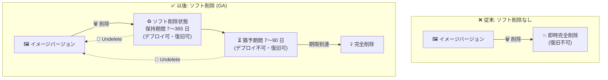

# Azure Compute Gallery: ソフト削除 (Soft Delete) の一般提供開始

**リリース日**: 2026-11-19

**サービス**: Azure Compute Gallery

**機能**: Soft delete in Azure Compute Gallery

**ステータス**: Launched (GA)

[このアップデートのインフォグラフィックを見る](https://takech9203.github.io/azure-news-summary/20261119-compute-gallery-soft-delete.html)

## 概要

Azure Compute Gallery のソフト削除 (Soft Delete) 機能が一般提供 (GA) となった。本機能により、誤って削除されたイメージバージョンを完全削除前に復旧できるようになる。Microsoft Ignite に合わせて発表されたアップデートであり、Private ギャラリー、Direct Shared ギャラリー、Community ギャラリーのすべてのギャラリータイプで利用可能。

ソフト削除が有効なギャラリーでイメージバージョンを削除すると、イメージは即座には削除されず「ソフト削除状態」に入り、「保持期間 (Retention Period) → 猶予期間 (Grace Period) → 完全削除」というライフサイクルをたどる。保持期間は 7〜365 日 (デフォルト 7 日)、猶予期間は 7〜90 日 (デフォルト 7 日) で設定可能。API バージョン `2026-03-03` を使用すると、保持期間中はソフト削除済みイメージからの VM / Virtual Machine Scale Sets (VMSS) のデプロイやスケールアウトも引き続き可能である点が特徴的で、ゴールデンイメージの誤削除が運用中のスケールアウトを止めるリスクを軽減できる。

ソフト削除自体は API バージョン `2024-03-03` から利用でき、保持期間・猶予期間のカスタマイズや保持期間中のイメージ利用 (consumption) は API バージョン `2026-03-03` で追加された。

**アップデート前の課題**

- イメージバージョンを削除すると即座に完全削除され、誤削除時の復旧手段がなかった (リソースロックや `safetyProfile` などの予防策しかなかった)
- ゴールデンイメージの誤削除により、VMSS のスケールアウトや VM デプロイが即座に失敗し、ワークフローの中断やデータ損失につながるリスクがあった

**アップデート後の改善**

- 削除されたイメージバージョンがソフト削除状態として保持され、`hardDeletionTargetTime` まで復旧 (Undelete) が可能になった
- API バージョン `2026-03-03` では、保持期間中はソフト削除済みイメージからの VM / VMSS デプロイ・スケールアウトを継続できるため、誤削除がデプロイパイプラインを即座に停止させない
- 保持期間 (7〜365 日)・猶予期間 (7〜90 日) を組織のガバナンス要件に合わせて設定できる

## アーキテクチャ図



従来はイメージバージョンの削除が即時かつ不可逆だったが、ソフト削除の GA により、保持期間・猶予期間中であれば Undelete 操作で復旧できるようになった。保持期間中 (API `2026-03-03` 使用時) はソフト削除済みイメージからのデプロイも継続可能。

## サービスアップデートの詳細

### 主要機能

1. **誤削除からの復旧 (Undelete)**
   - ソフト削除されたイメージバージョンは、完全削除予定時刻 (`hardDeletionTargetTime`) まで Azure Portal / REST / CLI (`az sig image-version undelete`) / PowerShell (`Restore-AzGalleryImageVersion`) で復旧可能
   - ソフト削除有効時に削除したイメージは、その後ギャラリーのソフト削除を無効化しても保持期間中は復旧可能

2. **保持期間中のイメージ利用継続 (API `2026-03-03`)**
   - 保持期間中はソフト削除済みイメージからの VM / VMSS 作成、既存 VMSS のスケールアウトが可能
   - `2026-03-03` より前の API バージョンでは、保持期間中でもソフト削除済みイメージからのデプロイは不可

3. **保持期間・猶予期間のカスタマイズ**
   - 保持期間: 7〜365 日 (デフォルト 7 日)。期間中は復旧・デプロイの両方が可能
   - 猶予期間: 7〜90 日 (デフォルト 7 日)。保持期間終了後に開始し、復旧のみ可能 (デプロイは不可)
   - 保持期間の変更は、変更後にソフト削除されたイメージにのみ適用 (既存のソフト削除済みイメージには影響しない)

4. **ソフト削除済みイメージの一覧表示とライフサイクルプロパティ**
   - `az sig image-version list-soft-deleted` / `Get-AzGallerySoftDeletedImageVersion` / Portal の「Show soft deleted versions」トグルで一覧表示
   - API `2026-03-03` から `softDeleteTime`、`consumptionEndTime`、`hardDeletionTargetTime`、`imageState` (`Active` / `SoftDeleted`) の各プロパティで状態を確認可能

5. **ハード削除 (バイパス) オプション**
   - 復旧ウィンドウが不要な場合、`bypassSoftDelete=true` でソフト削除を経由せず即時完全削除が可能
   - ソフト削除状態のイメージも、保持期間・猶予期間の終了を待たずにハード削除でき、保持コストを打ち切れる

## 技術仕様

| 項目 | 詳細 |
|------|------|
| 最小 API バージョン | `2024-03-03` (ソフト削除の基本機能) |
| 推奨 API バージョン | `2026-03-03` (保持期間・猶予期間のカスタマイズ、保持期間中のデプロイ、ライフサイクルプロパティ) |
| 保持期間 (Retention Period) | 7〜365 日、デフォルト 7 日。復旧可・デプロイ可 (API `2026-03-03`) |
| 猶予期間 (Grace Period) | 7〜90 日、デフォルト 7 日。復旧可・デプロイ不可 |
| 対応ギャラリータイプ | Private / Direct Shared Gallery / Community Gallery |
| 対象リソース | Azure Compute Gallery のイメージのみ (VM Apps の復旧は非対応) |
| 設定プロパティ (REST) | `properties.softDeletePolicy.isSoftDeleteEnabled` / `retentionPeriodInDays` / `gracePeriodInDays` |
| ライフサイクルプロパティ | `softDeleteTime` / `consumptionEndTime` / `hardDeletionTargetTime` / `imageState` |
| 有効化できるユーザー | サブスクリプション所有者、またはサブスクリプション / ギャラリーレベルで Compute Gallery Sharing Admin ロールを割り当てられたユーザー・サービスプリンシパル |

## 設定方法

### 前提条件

1. API バージョン `2024-03-03` 以降 (保持期間・猶予期間のカスタマイズには `2026-03-03`)
2. サブスクリプション所有者、または Compute Gallery Sharing Admin ロール (サブスクリプションまたはギャラリーレベル)
3. ソフト削除が GA 提供されているリージョンのギャラリーであること (後述の「利用可能リージョン」参照)

### Azure CLI

```bash
# ソフト削除を有効にしてギャラリーを作成 (保持期間 7 日、猶予期間 30 日)
az sig create \
    --resource-group myResourceGroup \
    --gallery-name myGallery \
    --location eastasia \
    --soft-delete true \
    --soft-delete-retention-period 7 \
    --soft-delete-grace-period 30

# ソフト削除済みイメージバージョンの一覧表示
az sig image-version list-soft-deleted \
    --resource-group myResourceGroup \
    --gallery-name myGallery \
    --gallery-image-definition myImageDefinition

# ソフト削除済みイメージバージョンの復旧 (location は元のホームリージョン)
az sig image-version undelete \
    --resource-group myResourceGroup \
    --gallery-name myGallery \
    --gallery-image-definition myImageDefinition \
    --gallery-image-version 1.0.0 \
    --location eastasia
```

### Azure PowerShell

```powershell
# ソフト削除を有効にしてギャラリーを作成
New-AzGallery `
    -ResourceGroupName "myResourceGroup" `
    -Name "myGallery" `
    -Location "eastasia" `
    -EnableSoftDelete `
    -SoftDeleteRetentionPeriodInDays 7 `
    -SoftDeleteGracePeriodInDays 30

# ソフト削除済みイメージバージョンの復旧
Restore-AzGalleryImageVersion `
    -ResourceGroupName "myResourceGroup" `
    -GalleryName "myGallery" `
    -GalleryImageDefinitionName "myImageDefinition" `
    -Name "1.0.0" `
    -Location "eastasia"
```

### Azure Portal

1. Azure Portal で「Azure compute galleries」を検索して選択し、「Create」を選択
2. 「Basics」タブの「Soft delete」セクションで「Enables soft delete for image versions」をオンにする
3. 保持期間 (7〜365 日) と猶予期間 (7〜90 日) を設定し、「Review + Create」で作成
4. 復旧する場合は、ギャラリーの「Image Definitions」ブレードで「Show soft deleted versions」トグルをオンにし、対象バージョンを選択して「Undelete」を実行

## メリット

### ビジネス面

- 誤削除によるゴールデンイメージの喪失リスクを排除し、イメージ管理のガバナンスを強化できる
- 保持期間中はデプロイを継続できるため、誤削除が本番ワークロードのスケールアウトやプロビジョニングを即座に停止させない
- ソフト削除機能自体は無料で、追加ライセンスコストなしで導入できる

### 技術面

- 保持期間 (最大 365 日)・猶予期間 (最大 90 日) を組織のポリシーに合わせて柔軟に設定可能
- `imageState` や `hardDeletionTargetTime` などのプロパティにより、削除済みイメージのライフサイクルをプログラムから追跡可能
- `bypassSoftDelete` によるハード削除も選択でき、不要なイメージの保持コストを即座に打ち切れる
- リソースロックや `safetyProfile.allowDeletionOfReplicatedLocations` などの既存の削除防止策を補完し、「防止」と「復旧」の両面で保護できる

## デメリット・制約事項

- GA 提供は 24 リージョンに限定される (下記「利用可能リージョン」参照)
- VM Applications の復旧は非対応 (対象は Compute Gallery のイメージのみ)
- ソフト削除済みリソースを含むギャラリーやイメージ定義は削除できない (すべてのソフト削除済みイメージを削除するか、ソフト削除を無効化する必要がある)
- ギャラリー / イメージ定義とイメージバージョンが異なるリージョンにある場合、ソフト削除の有効化およびイメージの復旧はできない
- ソフト削除状態でもレプリカ数は減らないため、完全削除までの保持期間・猶予期間中はすべてのレプリカのストレージ課金が継続する
- 保持期間の変更は既存のソフト削除済みイメージには適用されない (変更後に削除されたイメージのみ対象)
- プロビジョニング失敗状態のイメージはソフト削除できず、ハード削除 (バイパス) が必要

## ユースケース

### ユースケース 1: ゴールデンイメージの誤削除対策

**シナリオ**: VMSS のゴールデンイメージを Compute Gallery で管理している環境で、運用者が誤って使用中のイメージバージョンを削除してしまった。

**実装例**:

```bash
# ソフト削除済みバージョンを確認
az sig image-version list-soft-deleted \
    --resource-group prodRG \
    --gallery-name prodGallery \
    --gallery-image-definition webServerImage

# 誤削除されたバージョンを復旧
az sig image-version undelete \
    --resource-group prodRG \
    --gallery-name prodGallery \
    --gallery-image-definition webServerImage \
    --gallery-image-version 2.1.0 \
    --location japaneast
```

**効果**: API `2026-03-03` 使用時は保持期間中もソフト削除済みイメージからの VMSS スケールアウトが継続するため、サービスを止めずに復旧作業を実施できる。

### ユースケース 2: イメージライフサイクルのガバナンス強化

**シナリオ**: コンプライアンス要件により、削除されたイメージを一定期間 (例: 90 日) 復旧可能な状態で保持する必要がある。

**実装例**:

```bash
# 保持期間 90 日、猶予期間 30 日でギャラリーを構成
az sig create \
    --resource-group complianceRG \
    --gallery-name complianceGallery \
    --location japaneast \
    --soft-delete true \
    --soft-delete-retention-period 90 \
    --soft-delete-grace-period 30
```

**効果**: 削除から最大 120 日間 (保持 90 日 + 猶予 30 日) 復旧ウィンドウを確保でき、監査・コンプライアンス要件に対応できる。

## 料金

ソフト削除機能自体は無料。ただし、ソフト削除状態になってもレプリカ数は減らないため、保持期間および猶予期間を通じて、完全削除までの間はすべての保持レプリカのストレージ (スナップショットとして課金) に対する課金が継続する。保持コストを早期に打ち切りたい場合は、ハード削除で即時完全削除が可能。

| 項目 | 料金 |
|------|------|
| ソフト削除機能 | 無料 |
| ソフト削除済みイメージのレプリカ保持 | 通常のイメージレプリカと同様にストレージ課金が継続 (完全削除まで) |

詳細は [Managed Disks 料金ページ](https://azure.microsoft.com/pricing/details/managed-disks/) を参照。

## 利用可能リージョン

GA 提供は以下の 24 リージョンに限定される:

| リージョン | リージョン | リージョン |
|-----------|-----------|-----------|
| Australia Central 2 | Australia East | Brazil South |
| Canada Central | Central US EUAP | East Asia |
| East US 2 EUAP | France South | Germany West Central |
| Japan East | Jio India West | Korea South |
| North Central US | North Europe | Norway East |
| Qatar Central | South Africa West | South Central US |
| Sweden Central | Taiwan North | UK South |
| UK West | West India | West US 3 |

## 関連サービス・機能

- **Azure Virtual Machines / Virtual Machine Scale Sets**: Compute Gallery のイメージから VM / VMSS をデプロイする。保持期間中のソフト削除済みイメージからのデプロイ・スケールアウトにも対応 (API `2026-03-03`)
- **リソースロック (Azure Resource Manager)**: ギャラリーレベルでの誤削除「防止」策。ソフト削除は削除後の「復旧」策として補完関係にある
- **イメージバージョンの safetyProfile**: `allowDeletionOfReplicatedLocations` や `BlockDeletionBeforeEndOfLife` による削除保護と組み合わせて多層防御を構成できる
- **Azure Monitor アクティビティログ**: ギャラリー・イメージ・バージョンの削除や構成変更の操作履歴を追跡できる

## 参考リンク

- [インフォグラフィック](https://takech9203.github.io/azure-news-summary/20261119-compute-gallery-soft-delete.html)
- [公式アップデート情報](https://azure.microsoft.com/updates?id=581907)
- [Soft Delete in Azure Compute Gallery (Microsoft Learn)](https://learn.microsoft.com/azure/virtual-machines/soft-delete-gallery)
- [Azure Compute Gallery 概要 (Microsoft Learn)](https://learn.microsoft.com/azure/virtual-machines/azure-compute-gallery)
- [Managed Disks 料金ページ](https://azure.microsoft.com/pricing/details/managed-disks/)

## まとめ

Azure Compute Gallery のソフト削除 GA により、これまで不可逆だったイメージバージョンの削除に「保持期間 + 猶予期間」の復旧ウィンドウが追加され、誤削除によるゴールデンイメージ喪失のリスクを大幅に低減できる。特に API バージョン `2026-03-03` では保持期間中のデプロイ継続が可能になり、誤削除が本番の VMSS スケールアウトを止めない点は運用上の大きな改善である。Compute Gallery でイメージを管理している環境では、対象リージョン (Japan East を含む 24 リージョン) であればソフト削除の有効化を推奨する。ただし、保持期間中はレプリカのストレージ課金が継続する点と、GA リージョンが限定されている点には留意が必要。

---

**タグ**: Azure Compute Gallery, Soft Delete, GA, Compute, Images, VMSS, Microsoft Ignite
