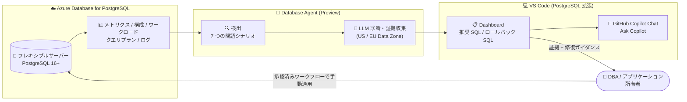

# Azure Database for PostgreSQL: Database Agent (パブリックプレビュー)

**リリース日**: 2026-11-19

**サービス**: Azure Database for PostgreSQL (フレキシブルサーバー)

**機能**: Database Agent for Azure Database for PostgreSQL

**ステータス**: In preview

[このアップデートのインフォグラフィックを見る](https://takech9203.github.io/azure-news-summary/20261119-postgresql-database-agent.html)

## 概要

Microsoft Ignite 2026 に合わせて、**Database Agent for Azure Database for PostgreSQL** がパブリックプレビューとして発表されました。Database Agent は、Azure Database for PostgreSQL フレキシブルサーバーにおけるデータベースの健全性・パフォーマンスの問題を、より迅速に「検出・理解・対応」できるようにする AI 支援の運用機能です。

Database Agent はデータベースの健全性をプロアクティブに監視して問題を特定し、**メトリクス・構成・ワークロードシグナル・クエリプラン・ログを統合**して根本原因を推定します。診断結果は根拠 (エビデンス) とともに平易な言葉で説明され、実行可能な修復ガイダンス (推奨 SQL、安全性の説明、ロールバック SQL を含む) が提示されます。ユーザーは証拠を確認したうえで、承認済みのワークフローを通じて手動で対応します。エージェントが状態を変更するアクションを自動実行することはありません。

Microsoft Learn のドキュメントによると、PostgreSQL 向け Database Agent は現時点では **Visual Studio Code (PostgreSQL 拡張機能) での限定プレビュー**として提供されており、利用には参加申請フォーム (https://aka.ms/databaseagent-form) による承認が必要です。Fabric Database Hub での提供は今後予定されています。

**アップデート前の課題**

- データベースの健全性・パフォーマンス問題の調査では、問題ごとにメトリクス、ログ、クエリ統計などのテレメトリと診断データを手動で突き合わせる必要があった
- Database Hub における PostgreSQL フレキシブルサーバーの監視は既存の Azure Monitor メトリクスベースで、問題の原因分析や対処方針の判断は担当者の経験と手作業の調査に依存していた
- Database Agent (2026-11-17 発表時点) は Azure SQL Database 向けのみが Database Hub で利用可能で、PostgreSQL 向けはごく限定的な提供だった

**アップデート後の改善**

- Database Agent がデータベースの健全性を継続的に監視し、接続枯渇・デッドタプルの肥大化・高 CPU・ロック競合など 7 種類の問題シナリオを自動検出するようになった
- メトリクス・構成・ワークロードシグナル・クエリプラン・ログを LLM が統合分析し、根本原因の推定と根拠を平易な言葉で提示するようになった
- 推奨 SQL・「なぜ安全か」の説明・ロールバック SQL・期待される効果まで含む修復ガイダンスが VS Code のダッシュボード上で提供され、調査時間を削減して解決に集中できるようになった

## アーキテクチャ図

Database Agent がフレキシブルサーバーのテレメトリを統合して問題を検出し、LLM が診断・修復ガイダンスを生成して VS Code のダッシュボードに提示します。変更の適用は必ず人間のレビューと承認済みワークフローを経由する手動対応です。

## サービスアップデートの詳細

### 主要機能

1. **プロアクティブな健全性監視と問題検出**
   - 保存されたエージェントポリシーに従って対象サーバーを継続的に評価し、サポート対象の問題シナリオを自動検出する
   - 有効化後、新しい Issue の生成まで約 15 分かかる場合がある

2. **AI による根本原因分析 (すべての調査が AI 支援)**
   - メトリクス、構成、ワークロードシグナル、クエリプラン、ログを統合し、LLM が状態を診断する
   - 問題のサマリー、分析、推奨アクション、期待される効果はすべて LLM が生成し、根拠とともに平易な言葉で説明される
   - AI モデルの処理は、米国リージョン (South Central US / West US 3) は **US Data Zone**、Sweden Central は **EU Data Zone** で実行される

3. **実行可能な修復ガイダンス**
   - **Recommended change** (生成された SQL、エディターで開く / コピー)、**Why this is safe** (安全性の説明)、**Rollback** SQL、**Expected outcome** (期待される効果とロールバック計画) を提示
   - エージェントは変更を自動実行しない。ユーザーが証拠を確認し、承認済みのデータベースワークフローを通じて手動で対応する

4. **VS Code ダッシュボードでの Issue 管理と Copilot 連携**
   - サーバーの Dashboard 上で Investigation バナーから Issue の重大度・ステータス (DETECTED / DIAGNOSED)・検出時刻・分析を確認
   - 対応完了後は **Mark manually applied**、対応不要なら **Dismiss issue** でトラッキング。クローズ後に問題が再発した場合は新しい Issue が作成され、履歴は保持される
   - 「Ask Copilot about this section」で Issue の構造化された詳細を GitHub Copilot Chat に読み込み、追加の質問やライブメトリクス・セッション・実行プランの調査が可能

### サポートされる問題シナリオ (PostgreSQL)

| シナリオ | 調査対象の状態 |
|------|------|
| 接続枯渇 (Connection exhaustion) | ロールの接続数上限、セッションの占有 (session hoarding) |
| デッドタプルの肥大化 (Dead tuple bloat) | デッドタプルの蓄積、HOT 更新の劣化、更新チャーンによるインデックス肥大化 |
| 高 CPU | インデックスタイプの不一致、古い統計情報、インデックスのないクエリ |
| Idle in transaction | アイドルトランザクションセッションによるスナップショット保持 |
| ロック競合 (Lock contention) | 行ロック、テーブルロック |
| クエリプランのリグレッション | Gather のボトルネック、結合タイプの誤選択、非可逆ビットマップ再チェック、サポートインデックスの削除 |
| ソートスピルとメモリ圧迫 | 全体集約・ハッシュ結合・大規模ソート・並列クエリによるスピル |

## 技術仕様

| 項目 | 詳細 |
|------|------|
| 対象サービス | Azure Database for PostgreSQL フレキシブルサーバー (PostgreSQL 16 以降) |
| 対応コンピューティング | Burstable、General Purpose、Memory Optimized の各ティアとデプロイ構成。Azure HorizonDB は今後対応予定 |
| 提供サーフェス | Visual Studio Code (PostgreSQL 拡張機能 1.32.0 以降)。Fabric Database Hub での提供は今後予定 |
| 利用申請 | 限定プレビューのため参加申請フォーム (https://aka.ms/databaseagent-form) による承認が必要 |
| 対応リージョン | South Central US、West US 3、Sweden Central |
| AI の利用 | PostgreSQL の調査はすべて LLM による AI 支援 (SQL 向けのコア調査が LLM 不使用である点と異なる)。AI 処理は US Data Zone / EU Data Zone で実行 |
| 認証・認可 | 既存の Microsoft Entra ID・Azure リソース権限・データベース権限をそのまま使用。追加のアクセス権付与や承認プロセスのバイパスはない |
| 変更の適用 | Issue から直接のデータベース変更は不可。すべて承認済みワークフローによる手動対応 |
| 調査のリトライ | リトライ可能なエラーは最大 3 回まで自動リトライ |

## 設定方法

### 前提条件

1. [参加申請フォーム](https://aka.ms/databaseagent-form)から限定プレビューへのアクセスを申請し、承認を受けること
2. サポート対象リージョン (South Central US / West US 3 / Sweden Central) で PostgreSQL 16 以降のフレキシブルサーバーが稼働中 (停止していない) であること
3. Visual Studio Code (MCP エージェントツール利用には 1.102.0 以降を推奨) と [PostgreSQL 拡張機能](https://learn.microsoft.com/azure/postgresql/development/vs-code-extension/postgresql-extension-overview) (1.32.0 以降) をインストールすること
4. Azure サーバーリソースへのアクセス権 (エージェント構成時はサーバーリソースへの Azure RBAC 書き込み権限) を持つ Microsoft Entra ID と、サーバーに接続するための PostgreSQL 資格情報・ネットワークアクセスがあること
5. (任意) 「Ask Copilot about this section」と Agent モードツールを使う場合は GitHub Copilot in VS Code をインストールすること

### 利用手順 (Visual Studio Code)

1. VS Code のアクティビティバーで **PostgreSQL** アイコンを選択し、**Connections** を開く
2. **Servers** で対象のフレキシブルサーバーに接続し、必要に応じて Azure アカウントでサインインする
3. 接続済みサーバーノードを右クリックし、**Database Agent** でエージェントを構成、または **Dashboard** でアクティブな調査と Issue を確認する
4. ツールバーに「Azure Server Detected」や「Incomplete Azure Metadata」が表示された場合は **Fetch Metadata** を選択して Azure リソース ID の解決を完了する
5. Issue を展開して分析・推奨アクション・ロールバック SQL を確認し、`pg_stat_activity` や `pg_locks` などでライブの状態を検証したうえで、承認済みワークフローで SQL 変更やサーバーパラメーター変更 (**Server Management** → **Server Parameters**) を手動適用する
6. 対応完了後に **Mark manually applied**、対応不要なら **Dismiss issue** を選択する

## メリット

### ビジネス面

- 問題ごとのテレメトリ・診断データの手動突き合わせが不要になり、調査にかける時間を削減して解決に集中できる
- DBA が不足している組織でも、接続枯渇やロック競合といった PostgreSQL 特有の典型的な問題の検出と一次分析を自動化できる
- 限定プレビュー期間中は調査に対する課金がなく、低リスクで評価を開始できる

### 技術面

- デッドタプル肥大化、idle in transaction、ソートスピルなど PostgreSQL 固有の問題シナリオに特化した診断が得られる
- 推奨 SQL に「なぜ安全か」の説明とロールバック SQL が付属し、`CREATE INDEX CONCURRENTLY` の利用やロック影響の確認など、レビューに必要な材料が揃う
- VS Code 内で検出から調査・検証 (Query Plan Visualizer、Queries / Waits / Sessions タブ)・対応・記録まで完結する
- 既存の Entra ID・Azure RBAC・データベース権限をそのまま使用し、追加のアクセス権付与がない

## デメリット・制約事項

- 限定プレビューのため、参加申請フォームによる承認が必要
- 対応リージョンは South Central US、West US 3、Sweden Central の 3 つに限定される
- PostgreSQL 16 以降のフレキシブルサーバーのみ対応 (Azure HorizonDB は今後対応予定)
- 現時点では VS Code の PostgreSQL 拡張機能経由のみで、Fabric Database Hub からは利用できない (今後対応予定)
- すべての調査が LLM によって生成されるため、診断・推奨 SQL・パラメーター変更は不完全または誤りの可能性があり、適用前にライブサーバーに対する検証が必須
- エージェントは変更を自動適用できない。すべてのシナリオで承認済みワークフローによる手動対応が必要
- 新しく有効化したサーバー・シナリオで Issue が生成されるまで約 15 分かかる場合がある
- プレビュー中はサポートされる問題・構成・リージョンが変更される可能性がある

## ユースケース

### ユースケース 1: 接続枯渇・ロック競合の早期検出とガイド付き対応

**シナリオ**: アプリケーションのコネクションリークや長時間トランザクションにより、接続枯渇や idle in transaction、ロック競合が断続的に発生しているが、発生時の状況を後から再現・分析するのが難しい。

**実装例**: 対象サーバーで Database Agent を構成し、Dashboard の Investigation バナーから検出された Issue を確認。証拠 (セッション・ロックの状態) をレビューし、`pg_stat_activity` / `pg_locks` でライブ状態を確認したうえで、推奨された対応 (例: 問題セッションの `pg_terminate_backend()`) を承認済みワークフローで実施する。

**効果**: 発生時点の証拠が自動収集されるため、再現待ちや手動のログ突き合わせが不要になり、初動から対応までの時間を短縮できる。

### ユースケース 2: デッドタプル肥大化・クエリ性能劣化のチューニング

**シナリオ**: 更新頻度の高いテーブルでデッドタプルの蓄積やインデックス肥大化が進行し、クエリプランのリグレッションや高 CPU が発生しているが、原因の切り分けに時間がかかっている。

**実装例**: Database Agent が検出した Issue の AI 分析 (古い統計情報、インデックスタイプの不一致、autovacuum 設定など) を確認し、推奨 SQL (例: `ANALYZE`、`CREATE INDEX CONCURRENTLY`) を Query Plan Visualizer の `EXPLAIN` 出力で検証してから適用。サーバーパラメーターの推奨 (例: `work_mem` や autovacuum 設定) は Server Management → Server Parameters から承認済みのメンテナンスウィンドウで変更する。

**効果**: 原因の切り分けと対処案の作成が自動化され、DBA は検証と適用判断に集中できる。ロールバック SQL が付属するため、変更の安全性も確保しやすい。

## 料金

- 限定プレビュー期間中、PostgreSQL の Database Agent による調査は **無償**
- 課金は一般提供 (GA) 前に開始され、開始前に登録顧客へ事前通知される
- 監視対象の Azure Database for PostgreSQL フレキシブルサーバー自体には通常の料金が適用される ([料金ページ](https://azure.microsoft.com/pricing/details/postgresql/flexible-server/))

## 利用可能リージョン

- **South Central US**、**West US 3** (AI 処理は US Data Zone)
- **Sweden Central** (AI 処理は EU Data Zone)

## 関連サービス・機能

- **Database Hub in Microsoft Fabric**: 複数データベースエンジンを横断する統合運用体験 (2026-11-17 に GA)。PostgreSQL 向け Database Agent の Database Hub 対応は今後提供予定で、現在はベースラインのエステート・メトリクス監視のみ利用可能
- **Database Agent for SQL (contextual Copilot)**: Azure SQL Database 向けの Database Agent (パブリックプレビュー、Database Hub で提供)。SQL のコア調査は LLM 不使用だが、PostgreSQL はすべての調査が LLM による AI 支援という違いがある
- **PostgreSQL extension for Visual Studio Code**: PostgreSQL 向け Database Agent の現在の提供サーフェス。Dashboard、Query Plan Visualizer、Server Management などの機能と統合
- **GitHub Copilot**: 「Ask Copilot about this section」で Issue の詳細を Copilot Chat に読み込み、対話的な深掘り調査が可能
- **Azure Monitor**: フレキシブルサーバーの既存のメトリクス監視。Database Agent はメトリクスに加えて構成・ワークロードシグナル・クエリプラン・ログを統合して診断する

## 参考リンク

- [インフォグラフィック](https://takech9203.github.io/azure-news-summary/20261119-postgresql-database-agent.html)
- [公式アップデート情報](https://azure.microsoft.com/updates?id=579579)
- [Microsoft Learn: Database Agents (Preview)](https://learn.microsoft.com/fabric/database/hub/database-agents?pivots=postgresql)
- [Microsoft Learn: Use Database Agents in Visual Studio Code (Preview)](https://learn.microsoft.com/fabric/database/hub/database-agents-vs-code)
- [Microsoft Learn: PostgreSQL extension for Visual Studio Code](https://learn.microsoft.com/azure/postgresql/development/vs-code-extension/postgresql-extension-overview)
- [限定プレビュー参加申請フォーム](https://aka.ms/databaseagent-form)
- [料金ページ: Azure Database for PostgreSQL フレキシブルサーバー](https://azure.microsoft.com/pricing/details/postgresql/flexible-server/)

## まとめ

Database Agent for Azure Database for PostgreSQL のプレビューにより、PostgreSQL フレキシブルサーバーでも「検出 → AI 診断 → 修復ガイダンス → 人間によるレビューと手動対応」というエージェント支援の運用ワークフローが利用可能になりました。接続枯渇、デッドタプル肥大化、ロック競合、クエリプランのリグレッションなど PostgreSQL 固有の 7 シナリオに対応し、推奨 SQL・安全性の説明・ロールバック SQL までを VS Code 内で提供する点が特長です。

現時点では参加申請が必要な限定プレビューで、対応リージョンは 3 リージョン、PostgreSQL 16 以降・VS Code 経由のみという制約があります。対象リージョンで PostgreSQL 16 以降を運用しているチームは、プレビュー期間中は無償のため、非本番環境での評価から始めることを推奨します。すべての診断が LLM 生成であるため、推奨事項は必ずライブサーバーで検証し、既存の変更管理プロセスと組み合わせて適用してください。

---

**タグ**: Azure Database for PostgreSQL, Database Agent, AI, Monitoring, Performance, VS Code, GitHub Copilot, Database Hub, Preview, Microsoft Ignite
