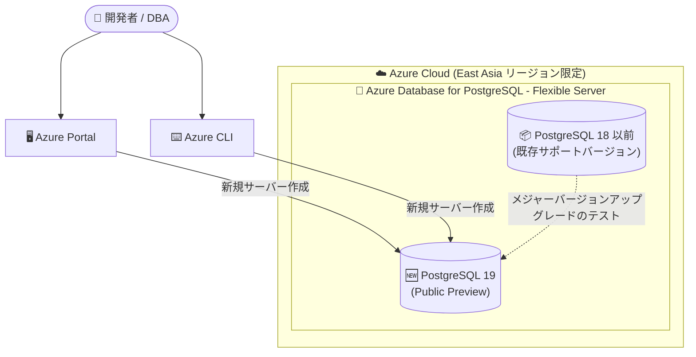

# Azure Database for PostgreSQL: PostgreSQL 19 パブリックプレビュー

**リリース日**: 2026-11-19

**サービス**: Azure Database for PostgreSQL - Flexible Server

**機能**: PostgreSQL 19 サポート (パブリックプレビュー)

**ステータス**: In preview

[このアップデートのインフォグラフィックを見る](https://takech9203.github.io/azure-news-summary/20261119-postgresql-flexible-server-pg19.html)

## 概要

Azure Database for PostgreSQL - Flexible Server で、PostgreSQL 19 がパブリックプレビューとして利用可能になりました。現時点では **East Asia (東アジア) リージョン限定** での提供です。

このプレビューでは、Azure Portal および Azure CLI から PostgreSQL 19 の新規サーバーをプロビジョニングできるほか、サポート対象の旧バージョンから PostgreSQL 19 へのメジャーバージョンアップグレードをテストできます。公式アナウンスでは "early access to PostgreSQL 19 in a fully managed Azure environment" と説明されており、GA に先立ってアプリケーション互換性の検証、ワークロード評価、移行準備を進められます。本アップデートは Microsoft Ignite のタイミングで発表されました。

**アップデート前の課題**

- Azure Database for PostgreSQL - Flexible Server で選択できる最新メジャーバージョンは PostgreSQL 18 までだった (Microsoft Learn のサポートバージョン一覧より)
- PostgreSQL 19 に対するアプリケーション互換性やアップグレードの検証を、マネージドな Azure 環境上で行うことができなかった

**アップデート後の改善**

- PostgreSQL 19 の新規サーバーを Azure Portal / Azure CLI からプロビジョニング可能になった (East Asia リージョン)
- サポート対象の旧バージョンから PostgreSQL 19 へのメジャーバージョンアップグレードを事前にテストできるようになった
- GA 前にフルマネージド環境で PostgreSQL 19 を早期評価できるようになった

## アーキテクチャ図



Azure Portal / Azure CLI から East Asia リージョンに PostgreSQL 19 の新規サーバーを作成できるほか、既存のサポートバージョンから PostgreSQL 19 へのアップグレードを検証できます。

## サービスアップデートの詳細

### 主要機能

1. **PostgreSQL 19 新規サーバーのプロビジョニング**
   - Azure Portal および Azure CLI から PostgreSQL 19 の Flexible Server を作成可能

2. **メジャーバージョンアップグレードのテスト**
   - サポート対象の旧バージョンから PostgreSQL 19 へのアップグレードシナリオを事前に検証可能

3. **GA 前の早期評価**
   - フルマネージド環境でアプリケーション互換性の検証やワークロード評価を実施し、GA に向けた準備が可能

## 技術仕様

| 項目 | 詳細 |
|------|------|
| 対象サービス | Azure Database for PostgreSQL - Flexible Server |
| 対象バージョン | PostgreSQL 19 |
| ステータス | パブリックプレビュー (GA 日は未定) |
| 対象リージョン | East Asia のみ |
| プロビジョニング方法 | Azure Portal、Azure CLI |
| 従来の最新サポートバージョン | PostgreSQL 18 (最新マイナー 18.6、Microsoft Learn 確認時点) |

## 設定方法

### 前提条件

1. Azure サブスクリプション
2. East Asia リージョンにリソースをデプロイできること (プレビューは East Asia 限定)
3. プレビュー機能のため、本番ワークロードではなくテスト・評価用途で利用すること

### Azure CLI

```bash
# East Asia リージョンに PostgreSQL 19 の Flexible Server を作成する例
az postgres flexible-server create \
  --resource-group myResourceGroup \
  --name mypg19server \
  --location eastasia \
  --version 19
```

### Azure Portal

Azure Portal で「Azure Database for PostgreSQL - Flexible Server」の作成画面に進み、リージョンに **East Asia** を選択したうえで、PostgreSQL バージョンとして **19** を選択してサーバーを作成します。

## メリット

### ビジネス面

- GA を待たずに PostgreSQL 19 への移行準備を開始でき、バージョンアップ計画を前倒しできる
- フルマネージド環境での検証により、自前で PG19 検証環境を構築・運用する負担を回避できる

### 技術面

- PostgreSQL 19 に対するアプリケーション互換性 (拡張機能、ドライバー、SQL 互換性) を実環境に近い構成で検証できる
- 旧バージョンから PostgreSQL 19 へのメジャーバージョンアップグレードのテストを事前に実施できる

## デメリット・制約事項

- プレビューは **East Asia リージョン限定** であり、他リージョンではまだ利用できない
- パブリックプレビューのため本番利用向けではない (Azure のプレビューは非本番用途・テスト用として提供される)
- GA 日は未定
- PostgreSQL 19 上での拡張機能サポート範囲など、プレビュー固有の制限の詳細はアナウンスページには記載されていない (最新情報は https://aka.ms/pg19 を参照)

## ユースケース

### ユースケース 1: PostgreSQL 19 へのメジャーバージョンアップグレードの事前検証

**シナリオ**: 現在 PostgreSQL 17/18 の Flexible Server を運用しており、PostgreSQL 19 GA 後に速やかにアップグレードしたい。GA 前に互換性問題を洗い出しておきたい。

**実装例**:

```bash
# 1. East Asia に PostgreSQL 19 の検証用サーバーを作成
az postgres flexible-server create \
  --resource-group rg-pg19-eval \
  --name pg19-eval-server \
  --location eastasia \
  --version 19

# 2. 既存データベースのスキーマ・データを投入し、アプリケーションの互換性テストを実施
```

**効果**: GA 前に互換性問題やパフォーマンス特性を把握でき、本番アップグレード時のリスクを低減できる。

## 料金

本アップデート固有の料金情報はアナウンスには記載されていません。Flexible Server の通常の料金体系 (コンピューティング + ストレージ + バックアップ) が適用されます。詳細は料金ページを参照してください。

- [Azure Database for PostgreSQL - Flexible Server 料金](https://azure.microsoft.com/pricing/details/postgresql/flexible-server/)

## 利用可能リージョン

- **East Asia (東アジア)** のみ (パブリックプレビュー時点)

## 関連サービス・機能

- **メジャーバージョンアップグレード機能**: Flexible Server のインプレース メジャーバージョンアップグレードにより、旧バージョンから上位バージョンへの移行が可能。本プレビューでは PG19 へのアップグレードテストが対象
- **Azure HorizonDB**: 同じ Ignite 2026 で発表された PostgreSQL 互換のフルマネージドデータベース (GA)。PostgreSQL エコシステムの選択肢として関連

## 参考リンク

- [インフォグラフィック](https://takech9203.github.io/azure-news-summary/20261119-postgresql-flexible-server-pg19.html)
- [公式アップデート情報](https://azure.microsoft.com/updates?id=574587)
- [詳細情報 (aka.ms/pg19)](https://aka.ms/pg19)
- [Microsoft Learn: サポートされている PostgreSQL バージョン](https://learn.microsoft.com/azure/postgresql/flexible-server/concepts-supported-versions)
- [Microsoft Learn: メジャーバージョンアップグレード](https://learn.microsoft.com/azure/postgresql/flexible-server/concepts-major-version-upgrade)
- [料金ページ](https://azure.microsoft.com/pricing/details/postgresql/flexible-server/)

## まとめ

Azure Database for PostgreSQL - Flexible Server で PostgreSQL 19 がパブリックプレビューになり、East Asia リージョンで新規サーバー作成とメジャーバージョンアップグレードのテストが可能になりました。従来は PostgreSQL 18 が最新サポートバージョンだったため、PG19 への移行を検討しているチームにとっては GA 前の互換性検証を始められる重要なマイルストーンです。現時点では East Asia 限定かつプレビューのため本番利用は避け、検証用途での早期評価と GA に向けたアップグレード計画の策定を推奨します。

---

**タグ**: Azure Database for PostgreSQL, Flexible Server, PostgreSQL 19, Public Preview, Databases, Microsoft Ignite
