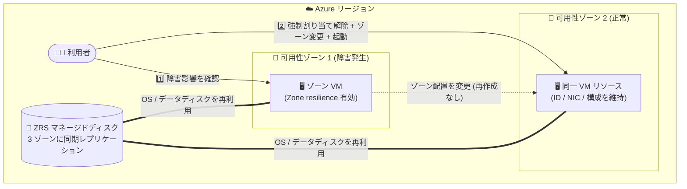

# Azure Virtual Machines: Zone resilience for Azure VMs (ゾーン レジリエンス)

**リリース日**: 2026-11-19

**サービス**: Azure Virtual Machines

**機能**: Zone resilience for Azure VMs (ゾーン レジリエンス)

**ステータス**: In preview

[このアップデートのインフォグラフィックを見る](https://takech9203.github.io/azure-news-summary/20261119-vm-zone-resilience.html)

## 概要

Azure VM の「Zone resilience (ゾーン レジリエンス)」がパブリックプレビューになりました。対象となるゾーン VM (特定の可用性ゾーンに配置された VM) を、同一リージョン内の別の可用性ゾーンへ復旧 (フェイルオーバー) できる機能です。フェイルオーバー時には新しい VM を作成するのではなく、既存の VM リソースのゾーン配置のみを変更します。VM のリソース ID・VM ID、アタッチされた NIC と IP 構成、ZRS マネージドディスク、その他のサポート対象の構成はそのまま維持されます。

本機能は ZRS (ゾーン冗長ストレージ) マネージドディスクを基盤としています。ZRS ディスクはデータをリージョン内の 3 つの可用性ゾーンに同期レプリケーションしますが、ディスク単体では障害の影響を受けた VM を別ゾーンで再起動することはできませんでした。Zone resilience は、サポートされる ZRS ディスクと VM 構成を再利用することで、ディスクにコミット済みのデータについて RPO (目標復旧時点) ほぼゼロのゾーン間復旧を実現します。

重要な点として、これは**顧客起点 (customer-initiated) の復旧オプションであり、自動フェイルオーバーではありません**。復旧にはダウンタイムが伴い、ターゲットゾーンの空き容量に依存します。また、プレビュー期間中は評価・テスト目的の非本番 VM での利用に限定されています。

**アップデート前の課題**

- ZRS ディスクはゾーン間でデータを同期レプリケーションするが、ゾーン障害の影響を受けた VM 自体を別ゾーンで再起動する仕組みはなかった
- ZRS データディスクは障害 VM から強制デタッチ (force detach) して別 VM にアタッチし直せるが、OS ディスクは強制デタッチに対応しておらず、VM リソースの作り直しが必要だった
- Azure Site Recovery のゾーン間 DR は事前のレプリケーション設定が必要で、フェイルオーバー時には別リソースグループに復旧用 VM が新規作成される (既存 VM リソースは維持されない)。また ZRS マネージドディスクは対象外で、RPO の SLA も定義されていない

**アップデート後の改善**

- 新しい VM リソースを作成せずに、既存 VM のゾーン配置を変更して復旧できる (リソース ID / VM ID / NIC / IP 構成を維持)
- コピーの復元ではなく、既存の ZRS OS ディスク・データディスクをそのまま再利用して復旧できる (コミット済みデータの RPO はほぼゼロ)
- ターゲットゾーンと復旧開始のタイミングを利用者が選択できる

## アーキテクチャ図



ゾーン 1 で障害が発生した際、利用者がフェイルオーバーを開始すると、既存 VM リソースのゾーン配置がゾーン 2 に変更され、ZRS ディスクをそのまま再利用して VM が起動します。VM の再作成やディスクコピーの復元は不要です。

## サービスアップデートの詳細

### 主要機能

1. **VM リソースを維持したままのゾーン変更**
   - フェイルオーバーは既存 VM のゾーン配置を変更するだけで、代替 VM を作成しない
   - リソース ID、VM ID、NIC と IP 構成、サポート対象の設定がそのまま維持される

2. **ZRS ディスクの再利用による RPO ほぼゼロの復旧**
   - ZRS マネージドディスクは 3 つの可用性ゾーンにデータを同期レプリケーション (耐久性 12 9's)
   - バックアップやコピーの復元ではなく、既存の OS / データディスクをそのまま再利用
   - ディスクにコミット済みのデータについて RPO ほぼゼロ (メモリ上のデータ、一時ディスク、処理中のリクエストは対象外)

3. **利用者によるフェイルオーバー制御**
   - ターゲットゾーンと復旧開始のタイミングを利用者が選択 (自動フェイルオーバーではない)
   - フェイルオーバーの流れ: 影響確認 → 強制割り当て解除 (force deallocate) → ゾーン配置変更 → ターゲットゾーンで起動 → 検証
   - Azure CLI では `az vm update --zone <target-zone>` の 1 コマンドで一連の操作をオーケストレーション可能

## 技術仕様

| 項目 | 詳細 |
|------|------|
| 対象 VM | 特定の可用性ゾーンに配置されたスタンドアロンのゾーン VM |
| OS ディスク | Premium SSD ZRS または Standard SSD ZRS 必須 |
| データディスク | すべてのディスクで Premium SSD ZRS または Standard SSD ZRS 必須 |
| パブリック IP (使用時) | ゾーン冗長の Standard SKU |
| ネットワークアプライアンス (使用時) | ゾーン冗長の Standard SKU ロードバランサーまたはサポート対象ゲートウェイ |
| RPO | ZRS ディスクにコミット済みのデータでほぼゼロ |
| フェイルオーバー方式 | 顧客起点 (自動フェイルオーバーなし)。ダウンタイムあり |
| 管理ツール | Azure Portal / Azure CLI 2.87.0 以降 / Azure PowerShell (Az 16.3.0 以降 + Az.Compute 11.9.0 以降) / Compute REST API `2026-03-01` / Bicep |
| 有効化のタイミング | ソースゾーンが正常なうちに有効化が必要 (既存 VM は割り当て解除してから有効化) |

## 設定方法

### 前提条件

1. 可用性ゾーンをサポートするリージョンで、特定ゾーンに配置された VM であること
2. OS ディスクとすべてのデータディスクが Premium SSD ZRS または Standard SSD ZRS であること (LRS ディスクの VM は [LRS から ZRS への変換](https://learn.microsoft.com/azure/virtual-machines/disks-migrate-lrs-zrs) で事前に移行)
3. ネットワークリソースはゾーン冗長の Standard SKU 構成であること
4. ソースゾーンが正常な状態で、事前に Zone resilience を有効化しておくこと

### Azure CLI

```bash
# 新規 VM 作成時に Zone resilience (zone movement) を有効化
az vm create \
  --resource-group "<resource-group-name>" \
  --name "<vm-name>" \
  --location "<region>" \
  --zone "<source-zone>" \
  --image Ubuntu2204 \
  --size "<vm-size>" \
  --admin-username azureuser \
  --generate-ssh-keys \
  --storage-sku Premium_ZRS \
  --zone-movement true

# 既存のゾーン VM で有効化 (割り当て解除が必要)
az vm deallocate --resource-group "<resource-group-name>" --name "<vm-name>"
az vm update --resource-group "<resource-group-name>" --name "<vm-name>" --zone-movement true
az vm start --resource-group "<resource-group-name>" --name "<vm-name>"

# 有効化の確認 (true が返る)
az vm show \
  --resource-group "<resource-group-name>" \
  --name "<vm-name>" \
  --query resiliencyProfile.zoneMovement.isEnabled \
  --output tsv

# ゾーン障害時のフェイルオーバー (強制割り当て解除 → ゾーン変更 → 起動を自動実行)
az vm update \
  --resource-group "<resource-group-name>" \
  --name "<vm-name>" \
  --zone "<target-zone>"
```

### Azure Portal

**新規 VM での有効化:**

1. VM 作成の「基本」タブで、可用性ゾーン対応リージョンを選択し、「可用性オプション」で「可用性ゾーン」と特定のゾーンを選択
2. 「Protect VM from zonal-failure with Zone resilience (Preview)」を選択し、「Enable Zone resilience (Preview)」を有効化して保存
3. 「ディスク」タブで OS ディスクとすべてのデータディスクに **Premium SSD ZRS** または **Standard SSD ZRS** を選択して作成

**フェイルオーバーの実行:**

1. VM の「概要」で「停止」を実行し、「停止済み (割り当て解除)」になるまで待機
2. 「可用性とスケーリング」の「可用性ゾーン」横の「(編集)」からターゲットゾーンを選択して適用
3. 更新成功後に「開始」を選択し、ゾーン・ディスク・ネットワーク・ワークロードの正常性を検証してからトラフィックを戻す

## メリット

### ビジネス面

- ゾーン障害からの復旧手段を事前に確保でき、単一 VM 構成のワークロードでも在リージョン復旧の選択肢が増える
- VM の再作成・リストアが不要なため、復旧手順がシンプルになり運用負荷と人的ミスのリスクを低減できる
- プレビュー期間中は機能自体の追加料金なしで評価可能

### 技術面

- VM のリソース ID / VM ID / NIC / IP 構成が維持されるため、周辺リソースや IaC 定義・監視設定への影響を最小化できる
- ZRS の同期レプリケーションにより、ディスクにコミット済みのデータは RPO ほぼゼロで復旧できる
- Portal / CLI / PowerShell / REST API / Bicep に対応し、既存の運用自動化に組み込みやすい

## デメリット・制約事項

- **自動フェイルオーバーではない**: 復旧は利用者が開始する必要があり、復旧中はワークロードが停止する。処理中のリクエスト、メモリ上のデータ、ランタイム状態は保持されない
- **ディスク要件が厳格**: OS ディスクとすべてのデータディスクが Premium SSD ZRS または Standard SSD ZRS である必要がある。LRS、エフェメラル OS ディスク、Premium SSD v2、Ultra Disk、Standard HDD、書き込みアクセラレータ付きデータディスクは非サポート
- **非サポート構成**: Virtual Machine Scale Sets、可用性セット内の VM、スポット VM、オンデマンドキャパシティ予約、専用ホスト、近接配置グループは非対応。Zone resilience 有効 VM では Azure Site Recovery も利用不可
- **容量依存**: ターゲットゾーンに VM サイズの十分な空き容量がない場合、フェイルオーバーが失敗することがある (その場合は別のゾーンを選択)
- **保護範囲は同一リージョン内**: リージョン全体の障害や複数ゾーンにまたがる障害からは保護されない。リージョン DR やマルチゾーン高可用性設計の代替にはならない
- **事前有効化が必須**: ソースゾーンが正常なうちに有効化しておく必要がある。有効化・無効化には VM の割り当て解除が必要
- **プレビュー制限**: 非本番 VM での評価・テスト用途に限定 (プレビューの追加利用規約が適用)

## ユースケース

### ユースケース 1: 単一ゾーン VM のゾーン障害対策の事前準備と復旧訓練

**シナリオ**: 冗長構成を組んでいないスタンドアロンのゾーン VM (開発・検証環境など) について、ゾーン障害時の復旧手段を事前に用意し、復旧手順を訓練しておきたい。

**実装例**:

```bash
# 1. ZRS ディスクで VM を作成し Zone resilience を有効化 (ゾーン 1)
az vm create \
  --resource-group rg-dr-test \
  --name vm-zr-test \
  --location japaneast \
  --zone 1 \
  --image Ubuntu2204 \
  --size Standard_D4s_v5 \
  --admin-username azureuser \
  --generate-ssh-keys \
  --storage-sku Premium_ZRS \
  --zone-movement true

# 2. ゾーン障害を想定し、ゾーン 2 へフェイルオーバー
az vm update --resource-group rg-dr-test --name vm-zr-test --zone 2

# 3. 復旧結果を検証
az vm show \
  --resource-group rg-dr-test \
  --name vm-zr-test \
  --show-details \
  --query "{zone:zones[0], zoneMovementEnabled:resiliencyProfile.zoneMovement.isEnabled, powerState:powerState}" \
  --output table
```

**効果**: VM を再作成せずにゾーン間復旧の手順を確立でき、ディスクにコミット済みのデータは RPO ほぼゼロで引き継がれる。復旧時間はフェイルオーバー操作とターゲットゾーンでの起動に要する時間に依存する。

### ユースケース 2: Azure Site Recovery との使い分けの評価

**シナリオ**: ゾーン間のフェイルオーバー手段として、Zone resilience と Azure Site Recovery (ゾーン間 DR) のどちらを採用すべきか評価する。

**判断基準** (公式ドキュメントの比較に基づく):

| 判断要素 | Zone resilience (Preview) | Azure Site Recovery (ゾーン間 DR) |
|----------|---------------------------|-----------------------------------|
| 対象ディスク | Premium SSD ZRS / Standard SSD ZRS 必須 | 対象の LRS ディスクをレプリケーション (ZRS は非対応) |
| RPO | コミット済みデータでほぼゼロ | RPO の SLA 定義なし |
| フェイルオーバーモデル | 既存 VM のゾーンを変更しディスクを再利用 | 事前レプリケーションし、別リソースグループに復旧 VM を作成。フェイルバック対応 |
| 適するケース | 既存 VM リソースと構成を維持したい、ZRS ディスクを使える | LRS ディスクの VM で事前にレプリケーションを構成できる |

**効果**: ディスク冗長性の方式 (ZRS か LRS か) と、VM リソースの同一性維持の要否によって、適切なゾーン間復旧手段を選択できる。

## 料金

プレビュー期間中、Zone resilience 自体の機能料金は無料です。GA 時には有料機能となる予定で、料金の詳細は GA リリース時に公開されます。

VM、ZRS マネージドディスク、ネットワークリソースには通常の料金が適用されます。ZRS ディスクの料金は以下を参照してください。

- [Azure Managed Disks の料金](https://azure.microsoft.com/pricing/details/managed-disks/)

## 利用可能リージョン

公式アップデートに個別のリージョン一覧は記載されていません。前提となる ZRS マネージドディスクは可用性ゾーンをサポートするすべてのリージョンで利用可能です ([Azure リージョン一覧](https://learn.microsoft.com/azure/reliability/regions-list) を参照)。

## 関連サービス・機能

- **ZRS マネージドディスク (Premium SSD ZRS / Standard SSD ZRS)**: 本機能の前提。3 つの可用性ゾーンへの同期レプリケーションにより RPO ほぼゼロの復旧を実現
- **Azure Site Recovery (ゾーン間 DR)**: LRS ディスク向けの代替手段。レプリケーションベースで復旧 VM を新規作成する方式。Zone resilience 有効 VM では利用不可
- **Azure Resource Health / Azure Service Health**: フェイルオーバー開始前に VM への障害影響とゾーン障害の状況を確認するために使用
- **可用性ゾーンへのマルチ VM 展開**: 無停止の高可用性が必要な場合は、本機能ではなく複数ゾーンへの VM 分散とトラフィック分散を推奨

## 参考リンク

- [インフォグラフィック](https://takech9203.github.io/azure-news-summary/20261119-vm-zone-resilience.html)
- [公式アップデート情報](https://azure.microsoft.com/updates?id=581254)
- [Zone resilience for Azure VMs (Preview) - Microsoft Learn](https://learn.microsoft.com/azure/virtual-machines/zone-resilience)
- [Redundancy options for Azure managed disks - Microsoft Learn](https://learn.microsoft.com/azure/virtual-machines/disks-redundancy)
- [LRS から ZRS へのディスク変換 - Microsoft Learn](https://learn.microsoft.com/azure/virtual-machines/disks-migrate-lrs-zrs)
- [Azure Managed Disks の料金](https://azure.microsoft.com/pricing/details/managed-disks/)

## まとめ

Zone resilience for Azure VMs は、ZRS マネージドディスクを使うゾーン VM を、VM リソースを再作成せずに同一リージョン内の別の可用性ゾーンへ復旧できるパブリックプレビュー機能です。リソース ID や NIC 構成を維持したまま、コミット済みデータを RPO ほぼゼロで復旧できる点が特長で、従来の「ZRS ディスクはあっても VM は作り直し」「ASR は別 VM を新規作成」という課題を解消します。一方で、自動フェイルオーバーではなくダウンタイムを伴う顧客起点の復旧であること、全ディスクに ZRS が必須なこと、VMSS や ASR 併用が非サポートであることに注意が必要です。Solutions Architect としては、マルチゾーン HA 構成までは不要だがゾーン障害からの復旧手段を確保したい単一 VM ワークロードの選択肢として、まず非本番環境で有効化とフェイルオーバー手順を評価することを推奨します。

---

**タグ**: Azure Virtual Machines, Availability Zones, ZRS, Managed Disks, Zone Resilience, High Availability, Disaster Recovery, Public Preview, Features
