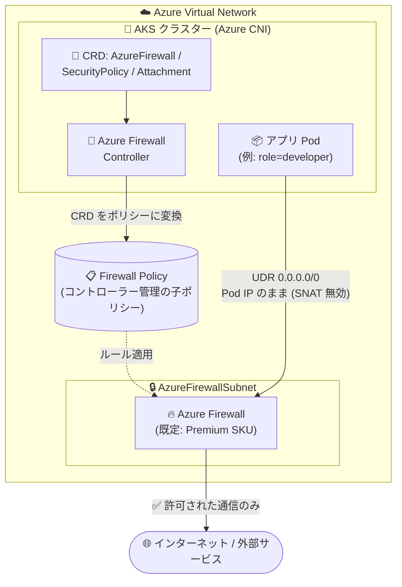

# Azure Firewall: Azure Firewall for Containers (Public Preview)

**リリース日**: 2026-11-20

**サービス**: Azure Firewall / Azure Kubernetes Service (AKS)

**機能**: Azure Firewall for Containers

**ステータス**: In preview

[このアップデートのインフォグラフィックを見る](https://takech9203.github.io/azure-news-summary/20261120-azure-firewall-for-containers.html)

## 概要

Azure Firewall for Containers がパブリックプレビューとして発表された。Azure Firewall の保護をコンテナーワークロードに拡張し、コンテナー環境のネットワークトラフィックを集中管理で保護する機能である。Microsoft Ignite に合わせて発表されたアップデートで、組織は Azure 全体のネットワークセキュリティ戦略の一部として Azure Firewall を活用しながら、コンテナーワークロードの保護を強化できる。

本機能の中核は、AKS クラスター上で動作する **Azure Firewall Controller** である。Kubernetes のカスタムリソース (CRD) として定義したファイアウォール設定・セキュリティポリシーを、コントローラーが Azure Firewall の構成と Firewall Policy に変換して適用する。これにより、Pod ラベルや namespace セレクターを使った Kubernetes ネイティブな粒度で、Azure Firewall のネットワークルール・アプリケーションルール・IDPS・脅威インテリジェンスなどを AKS ワークロードの egress トラフィックに適用できる。

**アップデート前の課題**

- 従来の AKS egress 制御では、UDR (ユーザー定義ルート) で 0.0.0.0/0 を Azure Firewall に向ける構成が一般的だったが、Pod のトラフィックはノード IP に SNAT (マスカレード) されるため、ファイアウォール側では Pod 単位・namespace 単位の識別ができず、クラスター (サブネット) 単位の一律のルールしか適用できなかった
- ファイアウォールルールの管理は Azure 側 (Portal / ARM / CLI) で行う必要があり、Kubernetes のラベルやマニフェストと連動しないため、アプリケーションチームのデプロイフローとセキュリティポリシー管理が分離していた

**アップデート後の改善**

- `SecurityPolicy` CRD の `podSelector` / `namespaceSelector` により、Pod ラベル・namespace 単位で許可/拒否ルールを定義できるようになった。ポリシー適用時にコントローラーが `azure-ip-masq-agent-config` を作成して Pod の SNAT を無効化し、ファイアウォールが Pod IP をソースとしてトラフィックを識別する
- ファイアウォール本体 (`AzureFirewall`)、ポリシー (`SecurityPolicy`)、適用 (`SecurityPolicyAttachment`) をすべて Kubernetes カスタムリソースとして宣言的に管理でき、コントローラーが Azure Firewall Policy (子ポリシー) へ自動変換する
- 既存ポリシーに一致するラベルを持つ新規 Pod は、ARM デプロイを介さず数秒でルールが適用される (fast-path 更新)

## アーキテクチャ図



AKS 上の Azure Firewall Controller が Kubernetes カスタムリソースを Azure Firewall Policy に変換し、UDR で Azure Firewall に向けられた Pod の egress トラフィックを Pod IP ベースで検査・制御する。

## サービスアップデートの詳細

### 主要機能

1. **3 つの CRD による宣言的な構成モデル**
   - `AzureFirewall`: Azure Firewall のデプロイを作成・管理する (既存ファイアウォールの Azure リソース ID 参照も可能)
   - `SecurityPolicy`: ネットワークルール、アプリケーションルール、および IDPS・DNS・脅威インテリジェンス・SNAT などの高度な設定を定義する
   - `SecurityPolicyAttachment`: ポリシーとファイアウォール、保護対象の AKS ワークロードサブネットを紐付ける。参照された複数ポリシーは 1 つの子 Firewall Policy に統合される

2. **Pod / namespace セレクターによるラベルベースのルール適用**
   - ルールコレクションの `refs` で `podSelector` / `namespaceSelector` を指定し、特定のラベルを持つ Pod のみに egress ルールを適用できる
   - 既存ポリシーに一致する新規 Pod は数秒で許可対象になる (ARM デプロイ不要の fast-path)

3. **ネットワークルールとアプリケーションルール**
   - `networkRuleCollections`: TCP / UDP / ICMP / ANY、ポート、IP アドレス、IP グループ、サービスタグ、FQDN (FQDN 使用時は `dnsProxy: Enabled` が必要)
   - `applicationRuleCollections`: HTTP / HTTPS / MSSQL、ポート、FQDN、FQDN タグ、URL、Web カテゴリ。`tlsInspection: Enabled` による TLS 検査にも対応 (Premium SKU + 証明書構成が必要)

4. **ポリシー全体の高度な設定**
   - IDPS: `Disabled` / `AlertOnly` / `AlertAndDeny`、シグネチャ単位のオーバーライド、プライベート IP 範囲指定
   - 脅威インテリジェンス: モード指定と CIDR / FQDN の許可リスト
   - DNS: DNS プロキシの有効化とカスタムネームサーバー
   - SNAT: `Always` / `Never` / `Exclude` (除外範囲の指定・自動学習)

5. **ベースポリシーの自動構成**
   - コントローラーがベースポリシーを作成する場合、AKS に必要な outbound ルール (`AzureKubernetesService` サービスタグ / FQDN タグ、`*.afc.azure.com` への HTTPS) が自動で許可される

## 技術仕様

| 項目 | 詳細 |
|------|------|
| 対象 | AKS クラスター上の Pod の egress (送信) トラフィックのみ、IPv4 のみ |
| 必須ネットワーク構成 | Azure CNI (Pod IP を VNet から割り当て)。**Azure CNI Overlay は非サポート** |
| API バージョン | `firewall.networking.azure.io/v1alpha1` (GA までに変更の可能性あり) |
| コントローラー配布 | Helm チャート `oci://mcr.microsoft.com/firewall/charts/azurefirewall-controller` (プレビュー対応バージョン: `20261109.1`) |
| 認証 | AKS Workload Identity (OIDC) + ユーザー割り当てマネージド ID (Network Contributor ロールが必要) |
| 既定の SKU | コントローラー管理のファイアウォール / ポリシーは Premium SKU。既存の Standard SKU も利用可能 (ただし IDPS / TLS 検査 / URL フィルタリングは不可) |
| ルーティング | AKS サブネットの UDR で 0.0.0.0/0 をファイアウォールのプライベート IP に向ける |
| SNAT 制御 | 初回のポリシーアタッチ時に `kube-system/azure-ip-masq-agent-config` を作成し Pod SNAT を無効化 |
| 構成上限 (プレビュー) | 1 AKS クラスターにつき 1 つの `SecurityPolicyAttachment`・1 つの Azure Firewall。1 ファイアウォールにつき 1 クラスター |

## 設定方法

### 前提条件

1. サポート対象プレビューリージョンでの Azure Firewall for Containers へのアクセス
2. 自己管理 VNet 内の Azure CNI 構成の AKS クラスター (Azure CNI Overlay は不可)
3. コントローラーのインストールとファイアウォール準備の間のクラスター outbound 接続経路
4. Pod トラフィックが Pod IP をソースとしてファイアウォールに到達すること (カスタム `ip-masq-agent` 構成がある場合は要確認)
5. 既存ファイアウォール / 独自ベースポリシー利用時は、AKS 必須 outbound ルールと `*.afc.azure.com` への HTTPS (443) の許可
6. ユーザー割り当てマネージド ID の作成とロール割り当ての権限、Azure CLI / kubectl / Helm

### Azure CLI / Helm / kubectl (主要ステップ)

```bash
# 1. Workload Identity 用のマネージド ID とフェデレーション資格情報を作成
az identity create --resource-group "$RESOURCE_GROUP" --name "$IDENTITY_RESOURCE_NAME"
az role assignment create --assignee-object-id "$IDENTITY_PRINCIPAL_ID" \
  --assignee-principal-type ServicePrincipal \
  --role 'Network Contributor' --scope "$RESOURCE_GROUP_ID"
az identity federated-credential create \
  --resource-group "$RESOURCE_GROUP" --identity-name "$IDENTITY_RESOURCE_NAME" \
  --name "$IDENTITY_RESOURCE_NAME" --issuer "$AKS_OIDC_ISSUER" \
  --subject "system:serviceaccount:${HELM_NAMESPACE}:azurefirewall-controller-sa" \
  --audience api://AzureADTokenExchange

# 2. Azure Firewall Controller を Helm でインストール
helm install azfw-controller \
  oci://mcr.microsoft.com/firewall/charts/azurefirewall-controller \
  --namespace "$HELM_NAMESPACE" --version "$CONTROLLER_VERSION" \
  --set "azfwController.podIdentity.clientID=$IDENTITY_CLIENT_ID" \
  --create-namespace

# 3. AzureFirewall カスタムリソースでファイアウォールを作成 (10〜15 分程度)
kubectl apply -f firewall.yaml

# 4. AKS サブネットの UDR をファイアウォールに向ける (ポリシーアタッチ前に必須)
az network route-table route create \
  --resource-group "$RESOURCE_GROUP" --route-table-name "$FW_ROUTE_TABLE_NAME" \
  --name to-firewall --address-prefix 0.0.0.0/0 \
  --next-hop-type VirtualAppliance --next-hop-ip-address "$FW_PRIVATE_IP"

# 5. SecurityPolicy と SecurityPolicyAttachment を適用
kubectl apply -f security-policy.yaml
kubectl apply -f attachment.yaml
```

`SecurityPolicy` の例 (ラベル `role: developer` の Pod に特定 FQDN への HTTPS のみ許可):

```yaml
apiVersion: firewall.networking.azure.io/v1alpha1
kind: SecurityPolicy
metadata:
  name: example-securitypolicy-rules
  namespace: default
spec:
  applicationRuleCollections:
    - name: test-application-rules
      refs:
        - podSelector:
            matchLabels:
              role: developer
      action: Allow
      egress:
        - name: allow-test-destinations
          toPortProtocol:
            - protocolType: HTTPS
              port: 443
          to:
            - fqdn:
                - "*.microsoft.com"
                - "*.google.com"
```

**重要**: ポリシーのアタッチで Pod SNAT が無効化されるため、ファイアウォールへの UDR を先に構成しないと、アタッチ後に Pod の outbound 接続が失われる可能性がある。ARM テンプレートで AKS クラスターとファイアウォールを一括作成するクイックスタートも提供されている。

## メリット

### ビジネス面

- コンテナー環境のネットワークセキュリティを Azure Firewall に集約し、VM・VNet と一貫したセキュリティ運用・監査が可能になる
- アプリケーションチームが Kubernetes マニフェストの一部としてセキュリティポリシーを管理でき、GitOps などの既存デプロイフローに統合できる

### 技術面

- Pod ラベル / namespace 単位の egress 制御により、同一クラスター内でワークロードごとに異なるルールを適用できる (従来のクラスター単位 UDR 構成では不可能だった粒度)
- IDPS、脅威インテリジェンス、TLS 検査、Web カテゴリフィルタリングなど Azure Firewall Premium の機能をコンテナートラフィックに適用できる
- 新規 Pod へのルール適用が数秒で完了する fast-path により、スケールアウト時もポリシー適用の遅延が小さい
- Azure が拒否したポリシーバージョンに対しては最後の正常バージョンを保持するフェイルセーフ動作

## デメリット・制約事項

- パブリックプレビューであり、プレビューの追加利用規約が適用される。CRD は `v1alpha1` で GA までに変更される可能性がある
- 1 クラスターにつき 1 アタッチメント・1 ファイアウォールのみ。1 ファイアウォールは 1 クラスター専用
- Pod の egress のみ検査対象 (ingress は対象外)。IPv4 のみ対応
- Azure CNI Overlay は非サポート。Pod IP を VNet から割り当てる Azure CNI 構成が必須
- ホストネットワークの Pod はノード IP を使用するため個別に選択できない
- 既存ファイアウォールは Firewall Policy 利用が必須 (クラシックルールは非サポート)。Standard SKU では IDPS / TLS 検査 / URL フィルタリングが使えない
- コントローラー管理の子ポリシーを Azure Portal から直接変更してはならない (Kubernetes が信頼できる唯一の情報源)
- ルートテーブルやクラスター outbound type の変更はクラスター接続を中断させる可能性があるため、隔離された評価環境での検証とロールバック計画が推奨される

## 料金

Azure Firewall 料金ページには、現時点で Azure Firewall for Containers (プレビュー) 固有の料金記載は確認できなかった。なお、コントローラー管理のファイアウォール / ポリシーは既定で Premium SKU としてデプロイされる点に留意する。Azure Firewall 自体は「デプロイごとの固定時間料金 + データ処理量 (GB) ごとの従量課金」の体系である。

詳細は料金ページを参照: [Azure Firewall の価格](https://azure.microsoft.com/pricing/details/azure-firewall/)

## 利用可能リージョン

プレビューは Azure パブリッククラウドの以下のリージョンで利用可能 (プレビューサブスクリプションで有効化されたリージョンを使用する):

| リージョン | Azure CLI 値 |
|------------|--------------|
| Central US EUAP | `centraluseuap` |
| East US 2 EUAP | `eastus2euap` |
| West Central US | `westcentralus` |
| East Asia | `eastasia` |
| UK South | `uksouth` |
| Central US | `centralus` |

## 関連サービス・機能

- **Azure Kubernetes Service (AKS)**: 保護対象のコンテナー実行基盤。Azure CNI、Workload Identity (OIDC)、outbound type の構成が本機能の前提となる
- **Azure Firewall Policy**: コントローラーが CRD を変換して作成・管理する子ポリシーの実体。既存のベースポリシーとの階層構成も可能
- **Azure Firewall Premium**: IDPS、TLS 検査、URL フィルタリングなど本機能で利用できる高度な保護機能を提供する SKU
- **Microsoft Entra Workload ID**: コントローラーが Azure リソースを操作するための認証基盤 (フェデレーション資格情報 + ユーザー割り当てマネージド ID)
- **Azure Firewall ログ (Azure Monitor)**: 許可 / 拒否されたトラフィックの確認・相関分析に使用する

## 参考リンク

- [インフォグラフィック](https://takech9203.github.io/azure-news-summary/20261120-azure-firewall-for-containers.html)
- [公式アップデート情報](https://azure.microsoft.com/updates?id=581963)
- [Deploy Azure Firewall for Containers (preview) - Microsoft Learn](https://learn.microsoft.com/en-us/azure/firewall/deploy-firewall-for-containers)
- [Customize cluster egress with outbound types - Microsoft Learn](https://learn.microsoft.com/en-us/azure/aks/egress-outboundtype)
- [AKS の必須 outbound ルール - Microsoft Learn](https://learn.microsoft.com/en-us/azure/aks/outbound-rules-control-egress)
- [料金ページ](https://azure.microsoft.com/pricing/details/azure-firewall/)

## まとめ

Azure Firewall for Containers は、従来「クラスター単位の UDR + ノード IP への SNAT」という粗い粒度でしか実現できなかった AKS の egress 制御を、Pod ラベル / namespace 単位の Kubernetes ネイティブなポリシー管理へと進化させるアップデートである。Azure Firewall Premium の IDPS・TLS 検査・脅威インテリジェンスをコンテナートラフィックに適用でき、セキュリティ要件の厳しい環境での AKS 採用を後押しする。一方で、Azure CNI Overlay 非対応、1 クラスター 1 ファイアウォールの制約、egress のみ・IPv4 のみといったプレビュー制限があるため、Solutions Architect はまず隔離された評価環境で検証し、既存の UDR ベース egress 構成からの移行パス (ルーティング変更とポリシーアタッチの順序、ロールバック計画) を設計することを推奨する。

---

**タグ**: Networking, Security, Compute, Containers, Azure Firewall, Azure Kubernetes Service (AKS), Features, Microsoft Ignite
