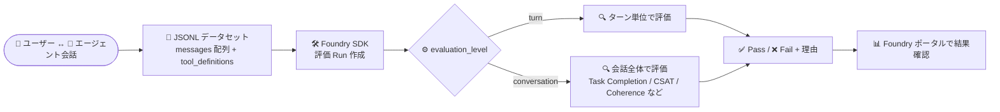

# Microsoft Foundry: マルチターン評価 (Multi-turn Evaluation) パブリックプレビュー

**リリース日**: 2026-11-20

**サービス**: Microsoft Foundry

**機能**: マルチターン評価 (Multi-turn evaluation)

**ステータス**: In preview

[このアップデートのインフォグラフィックを見る](https://takech9203.github.io/azure-news-summary/20261120-foundry-multi-turn-evaluation.html)

## 概要

Microsoft Foundry において、エージェントの会話全体を品質基準に照らして評価できる「マルチターン評価」がパブリックプレビューとして発表されました。従来の評価は個々の応答 (ターン) 単位が中心でしたが、本機能により複数ターンにまたがる会話を 1 つの単位として評価できるようになります。本アップデートは Microsoft Ignite に合わせて発表されたものです。

個々の応答は単体では正しく見えても、会話全体としてはユーザーの要求を満たせていないケースがあります。たとえば、エージェントが同じ失敗するアクションを複数ターンにわたって繰り返し、結局リクエストが未解決のまま終わるようなパターンは、ターンレベルのスコアでは検出できません。公式ドキュメントでは、パスワードリセットのサポート会話で「エージェントがリセットリンクの再送を 3 回繰り返し、代替手段を試さずユーザーの問題が未解決のまま」という例が示されており、ターンレベル評価では最後の応答 (丁寧でアクションも取っている) が高スコアになる一方、会話レベルの顧客満足度評価ではこの問題を検出できるとされています。

マルチターン評価では、評価実行 (run) の `evaluation_level` パラメーターで「各ターンを個別に評価」するか「会話全体を評価」するかを選択できます。会話データは `messages` 配列 (ツール呼び出し・ツール定義を含む) を持つ JSONL として用意し、Foundry SDK で評価を実行します。

**アップデート前の課題**

- 評価がターン (個々のクエリ・応答ペア) 単位であり、会話全体としてのタスク未解決、ユーザーの不満の蓄積、ツール呼び出しのリグレッションといった問題を検出できなかった
- 単体では適切に見える応答が、会話の文脈ではユーザーの要求を満たしていないケース (同じ失敗アクションの繰り返しなど) を見逃していた

**アップデート後の改善**

- `evaluation_level` を `conversation` に設定することで、会話全体を 1 つの単位としてスコアリングできるようになった
- タスク完了 (Task Completion)、顧客満足度 (Customer Satisfaction)、一貫性 (Coherence)、根拠性 (Groundedness)、ツール使用品質 (Tool Use Quality) などの会話レベルエバリュエーターにより、タスクの未完了、ユーザーの不満、ツール呼び出しのリグレッションといった問題を検出できるようになった

## アーキテクチャ図



エージェントの会話ログを `messages` 配列を含む JSONL として用意し、Foundry SDK で評価を実行します。`evaluation_level` の指定により、ターン単位または会話全体のどちらのレベルで品質判定するかを切り替えられます。

## サービスアップデートの詳細

### 主要機能

1. **評価レベルの選択 (`evaluation_level`)**
   - 評価 Run に `"turn"` (各ターンを独立して評価) または `"conversation"` (会話全体を評価) を指定できる。省略時のデフォルトは `"turn"`
   - 会話レベルに対応しないエバリュエーター (例: `builtin.fluency`、`builtin.relevance`) を `conversation` レベルで指定した場合、評価全体が失敗するのではなく該当エバリュエーターがスキップされる

2. **会話レベル対応の組み込みエバリュエーター**
   - ターンレベルと会話レベルの両方に対応: `builtin.output_quality`、`builtin.tool_use_quality`、`builtin.deflection_rate`、`builtin.customer_satisfaction`、`builtin.task_completion`、`builtin.coherence`、`builtin.groundedness`
   - `output_quality` と `tool_use_quality` は複数の品質次元を 1 回の LLM ジャッジ呼び出しでまとめて評価するコンポジットエバリュエーター

3. **ツール呼び出しを含む会話データへの対応**
   - JSONL の各行に会話全体の `messages` 配列を格納。ツール呼び出し (`tool_calls`)、ツール結果 (`role: tool`)、ツール定義 (`tool_definitions`) も含められる
   - ツール呼び出しのリグレッション検出など、エージェントのツール利用プロセス全体の品質評価が可能

4. **複数の評価ワークフロー**
   - ローカルの会話トレースやテストデータ (JSONL、`file_id` / `file_content`)
   - Application Insights 上のデプロイ済み会話・サンプリングされた本番トラフィックの評価 (`azure_ai_trace_data_source_preview`)
   - 合成テスト会話のシミュレーション生成 (`azure_ai_user_conversation_simulation`)

### ターンレベル評価との比較

| 観点 | ターンレベル | 会話レベル |
|------|-------------|-----------|
| スコープ | 個々のクエリ・応答ペア | 複数のやり取りを含む会話全体 |
| メトリクス | 応答ごとの品質・安全性 | 会話全体の成果・ユーザー満足度 |
| データ形式 | `query` / `response` フィールドの JSONL | 会話全体の `messages` 配列を含む JSONL |
| ユースケース | 個々のモデル応答のテスト | エンドツーエンドのエージェント体験のテスト |

## 技術仕様

| 項目 | 詳細 |
|------|------|
| 評価レベル | `turn` (デフォルト) / `conversation` |
| データ形式 | JSONL (各行に `messages` 配列、任意で `tool_definitions`) |
| メッセージ構造 | OpenAI メッセージ形式 (`role`: user / assistant / system / tool、`content`、`tool_calls`) |
| 会話レベル対応エバリュエーター | `output_quality`、`tool_use_quality`、`deflection_rate`、`customer_satisfaction`、`task_completion`、`coherence`、`groundedness` |
| 実行方法 | Foundry SDK (Python `azure-ai-projects>=2.2.0`、C#、JavaScript/TypeScript)、REST API (`2025-11-15-preview`) |
| コンポジットエバリュエーターの判定 | 適用されたすべてのコンポーネントが Pass の場合のみ Pass。コンポーネントごとのスコア・理由も返却 |
| 対応ツール (エージェント評価) | File Search、Function Tool、MCP、Knowledge-based MCP (Bing Grounding、Code Interpreter などは一部エバリュエーターで制限あり) |

## 設定方法

### 前提条件

1. Foundry プロジェクトとクラウド評価の前提条件 (SDK クライアントのセットアップ) を完了していること
2. `messages` 配列を含む会話データ (JSONL) を用意していること
3. 選択した評価レベルに対応するエバリュエーターを使用すること

### Foundry SDK (Python)

```bash
pip install "azure-ai-projects>=2.2.0"
```

```python
# 会話データ (JSONL) をアップロードし、会話レベルで評価を実行
data_id = project_client.datasets.upload_file(
    name="multiturn-conversation-data",
    version="1",
    file_path="./sample_data_multiturn_conversations.jsonl",
).id

eval_object = openai_client.evals.create(
    name="Multi-turn Conversation Evaluation",
    data_source_config=data_source_config,   # messages / tool_definitions のスキーマ
    testing_criteria=testing_criteria,       # builtin.task_completion などの評価基準
)

eval_run = openai_client.evals.runs.create(
    eval_id=eval_object.id,
    name="multiturn-conversation-run",
    data_source=CreateEvalJSONLRunDataSourceParam(
        type="jsonl",
        source=SourceFileID(type="file_id", id=data_id),
    ),
    extra_body={"evaluation_level": "conversation"},  # 会話レベルを指定
)
```

### 会話データの例 (JSONL)

```json
{"messages": [{"role": "user", "content": "What's my account balance?"}, {"role": "assistant", "content": "Your current balance is $1,234.56."}, {"role": "user", "content": "Thanks!"}, {"role": "assistant", "content": "You're welcome! Is there anything else?"}]}
```

ツールを使うエージェントの場合は、`tool_calls` を含む assistant メッセージ、`role: tool` のツール結果、および `tool_definitions` を同じ行に含めます。

## メリット

### ビジネス面

- ユーザー体験全体 (タスクが最終的に解決されたか、ユーザーが満足したか) を品質基準として計測でき、エージェントの実運用品質を定量化できる
- ターンレベルでは見逃されていた「丁寧だが問題を解決しないエージェント」のような品質問題を出荷前・運用中に検出できる

### 技術面

- `evaluation_level` パラメーターの切り替えだけでターン評価と会話評価を使い分けられ、既存の評価パイプラインに組み込みやすい
- コンポジットエバリュエーター (`output_quality`、`tool_use_quality`) により複数の品質次元を 1 回の LLM ジャッジ呼び出しで評価でき、評価コストとレイテンシを削減できる
- データセット評価だけでなく、Application Insights の本番トレース評価やシミュレーション会話の評価にも同じ仕組みを利用できる

## デメリット・制約事項

- パブリックプレビューのため SLA はなく、本番ワークロードでの利用は推奨されない (Azure プレビューの追加利用条件が適用される)
- 会話レベルに対応するのは一部の組み込みエバリュエーターのみ。ターン専用エバリュエーター (`builtin.fluency`、`builtin.relevance` など) は `evaluation_level="conversation"` ではスキップされる
- Foundry IQ (Azure AI Search)、Bing Grounding、Code Interpreter、SharePoint Grounding などのツール呼び出しを含む会話では、`tool_call_accuracy` や `groundedness` など一部エバリュエーターのサポートが限定的
- Azure OpenAI グレーダー (`label_model`、`python_grader`、`score_model`、`string_check`、`text_similarity`) は `messages` 入力形式に対応していない

## ユースケース

### ユースケース 1: カスタマーサポートエージェントの会話品質ゲート

**シナリオ**: サポートエージェントが複数ターンの会話でユーザーの問題を実際に解決できているかを、リリース前のテストデータセットで検証する。

**実装例**: 過去の会話ログを `messages` 配列の JSONL に変換し、`builtin.task_completion` と `builtin.customer_satisfaction` を `evaluation_level="conversation"` で実行。Pass/Fail 判定を CI/CD の品質ゲートとして利用する。

**効果**: 「同じ失敗アクションの繰り返し」「タスク未解決のまま会話終了」といったターンレベル評価では検出できない品質問題を出荷前に発見できる。

### ユースケース 2: ツール呼び出しリグレッションの検出

**シナリオ**: エージェントのプロンプトやツール定義を変更した際に、会話全体を通じたツール利用品質が劣化していないかを確認する。

**実装例**: `tool_definitions` を含む会話データセットに対して `builtin.tool_use_quality` (ツール選択・入力精度・出力活用・呼び出し成功をまとめて評価) を会話レベルで実行し、変更前後の結果を比較する。

**効果**: ツール呼び出しのリグレッションを変更のたびに自動検出し、エージェント改善の反復サイクルを安全に回せる。

## 料金

Foundry のオブザーバビリティ機能 (リスク・安全性評価、エージェントプレイグラウンドでの評価など) は消費量ベースで課金されます。また、AI 支援エバリュエーターは LLM ジャッジモデルのトークン消費が発生します。詳細は公式の料金ページを参照してください。

- [Microsoft Foundry Observability 料金ページ](https://azure.microsoft.com/pricing/details/foundryobservability/)

## 利用可能リージョン

AI 支援エバリュエーターのリージョン対応、レート制限、仮想ネットワーク対応は公式ドキュメントを参照してください。

- [Region support, rate limits, and virtual network support for evaluation](https://learn.microsoft.com/azure/ai-foundry/concepts/evaluation-regions-limits-virtual-network)

## 関連サービス・機能

- **Foundry Agent Service**: マルチターン会話、ツール呼び出し、状態管理を備えたエージェントの構築基盤。本機能の主な評価対象
- **Azure Monitor Application Insights**: 本番トレースの収集先。デプロイ済み会話・サンプリングされた本番トラフィックの会話レベル評価に利用
- **Foundry 組み込みエバリュエーター**: Task Completion、Customer Satisfaction、Coherence、Groundedness、Tool Use Quality など、会話レベル評価を構成する評価器群
- **継続的評価 (Continuous evaluation)**: 本番トラフィックをサンプリングして品質・安全性を継続評価する仕組み。会話レベル評価と組み合わせて運用中の品質監視に利用

## 参考リンク

- [インフォグラフィック](https://takech9203.github.io/azure-news-summary/20261120-foundry-multi-turn-evaluation.html)
- [公式アップデート情報](https://azure.microsoft.com/updates?id=581746)
- [Evaluate conversation datasets with the Microsoft Foundry SDK (Microsoft Learn)](https://learn.microsoft.com/azure/foundry/observability/how-to/cloud-evaluation-conversations)
- [Agent Evaluators for Generative AI (Microsoft Learn)](https://learn.microsoft.com/azure/ai-foundry/concepts/evaluation-evaluators/agent-evaluators)
- [Observability in Generative AI (Microsoft Learn)](https://learn.microsoft.com/azure/ai-foundry/concepts/evaluation-approach-gen-ai)
- [料金ページ (Foundry Observability)](https://azure.microsoft.com/pricing/details/foundryobservability/)

## まとめ

Microsoft Foundry のマルチターン評価により、エージェント評価の単位が「個々の応答」から「会話全体」へと拡張されました。`evaluation_level="conversation"` を指定するだけで、タスク完了・顧客満足度・一貫性・根拠性・ツール使用品質といった観点から会話全体を評価でき、ターンレベル評価では見逃されるタスク未解決やユーザーの不満の蓄積を検出できます。エージェントを本番運用している、または運用を計画している組織は、既存の評価パイプラインに会話レベル評価を追加し、CI/CD の品質ゲートや本番トラフィックの継続評価への組み込みを検討することを推奨します。なおパブリックプレビューのため、対応エバリュエーターの範囲やツールサポートの制限を確認のうえ利用してください。

---

**タグ**: AI + machine learning, Microsoft Foundry, Features, Microsoft Ignite, In preview, Evaluation, Agent
