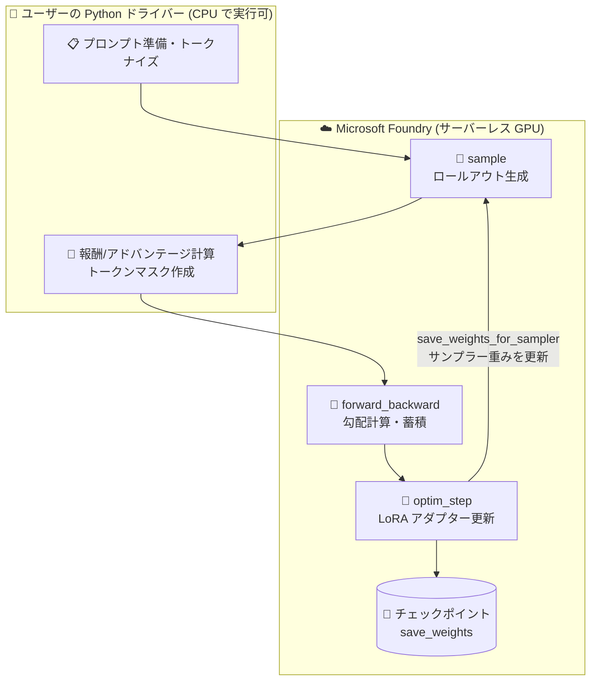

# Microsoft Foundry: Programmed Training (パブリックプレビュー)

**リリース日**: 2026-11-20

**サービス**: Microsoft Foundry

**機能**: Programmed Training

**ステータス**: In preview

[このアップデートのインフォグラフィックを見る](https://takech9203.github.io/azure-news-summary/20261120-foundry-programmed-training.html)

## 概要

Microsoft Foundry で、オープンウェイトモデルに対する独自のポストトレーニングループを構築するための API「Programmed Training」がパブリックプレビューとして発表された (Microsoft Ignite での発表)。ユーザーは Python プログラムで実験全体を制御し、Foundry がサーバーレス GPU 上でモデルのサンプリングと LoRA (Low-Rank Adaptation) アダプターの更新を実行する役割分担となる。

強化学習 (RL) では、ロールアウトの収集、報酬・アドバンテージの計算、更新スケジューリングをユーザーのコードが制御する。同じビルディングブロック (プリミティブ) で、教師あり学習 (SFT)、選好学習、蒸留、カスタム損失のワークフローもサポートされる。アダプターとオプティマイザーの状態は保存でき、互換性のあるセッションで再開できる。

利用にはプレビューサインアップフォームからのリクエストと承認が必要なリクエスト制アクセスとなっている。

**アップデート前の課題**

- マネージドトレーニングジョブはデータセット、グレーダー (採点器)、ジョブ設定の制御には適していたが、カスタムな学習シグナル (独自の報酬関数や損失関数など) を必要とする研究チームは、独自の GPU インフラを維持する必要があった
- トレーニングループ自体 (勾配蓄積のタイミング、オプティマイザー更新のタイミング、トークン単位の学習対象選択など) を制御する手段が Foundry 上になかった

**アップデート後の改善**

- ユーザーの Python プログラム (ドライバー) が実験を制御し、Foundry がサーバーレス GPU 上でサンプリングと LoRA 更新を実行する。トレーニング用 GPU のプロビジョニングは不要
- ロールアウト収集、報酬・アドバンテージ計算、学習に寄与するトークンの選択 (トークンマスク)、オプティマイザー更新のタイミングをすべてユーザーのコードが決定できる
- RL、教師あり学習、選好学習、蒸留、カスタム損失を同一のプリミティブで実現できる
- アダプターとオプティマイザーの状態をチェックポイントとして保存し、互換セッションで学習を再開できる

## アーキテクチャ図

ユーザーの Python ドライバーがトークナイズ・報酬計算・実験スケジューリングを担い、Foundry 側がサーバーレス GPU 上でサンプリング、勾配計算、オプティマイザー更新、チェックポイント管理を実行する。更新後はサンプラー重みをリフレッシュして次のロールアウト収集に戻るループ構造となる。

## サービスアップデートの詳細

### 主要機能

1. **ステートフルなトレーニングセッション**
   - `FineTuningSession.create` でサポート対象のベースモデルと LoRA アダプター構成を初期化。勾配計算、オプティマイザー更新、サンプリングが独立した操作として分離されており、データ収集・勾配蓄積・更新・評価のタイミングを自由に選択できる

2. **トークン単位の学習制御**
   - `Datum` がモデル入力と損失入力を保持し、マスクによって学習に寄与するトークン (例: プロンプトやツール観測ではなくアシスタント応答のトークン) を選択できる

3. **サンプリングと勾配計算の分離**
   - `sample` は選択したサンプラーチェックポイントから応答を生成。`forward` は勾配を蓄積せずに損失関数の出力を返し、`forward_backward` は選択した目的関数の勾配を計算・蓄積する (オプティマイザー更新は行わない)

4. **明示的なオプティマイザー更新**
   - `optim_step` が蓄積済み勾配を Adam パラメーターで適用する。更新のタイミングと学習率をユーザーが決定する

5. **チェックポイントと再開**
   - `save_weights_for_sampler` で生成用のアダプター重みを準備、`save_weights` でアダプター重みとオプティマイザー状態を永続化。`FineTuningSession.create_from_checkpoint` で互換セッションにてトレーニングを再開できる

6. **損失プリミティブ**
   - SDK には教師あり更新用の `cross_entropy`、RL 用の `importance_sampling` と `ppo` が含まれる。これらは事前定義のエンドツーエンドアルゴリズムではなく損失プリミティブであり、カスタム損失の組み合わせが可能

### RL ループの動作 (公式ドキュメントの例)

1. 学習アダプターからサンプラー重みを保存し、プロンプトごとに複数の応答 (ロールアウト) を収集する
2. 報酬関数が各ロールアウトをスコアリングし、プロンプトグループの平均報酬を差し引いてアドバンテージを算出する
3. サンプリングされたアシスタントトークンをロールアウトのログ確率・アドバンテージと対応付け、プロンプトや環境観測は学習シグナルから除外する
4. バッチを `importance_sampling` 付きで `forward_backward` に送信して勾配を計算する
5. `optim_step` でアダプターを更新し、更新後のポリシーから応答を収集する前にサンプラー重みをリフレッシュする
6. ホールドアウトでの正答率をベースラインと比較し、任意のタイミングでトレーニングチェックポイントを保存する

## 技術仕様

| 項目 | 詳細 |
|------|------|
| 提供形態 | API + Python SDK (プレビュー) |
| アクセス | リクエスト制 ([プレビューサインアップフォーム](https://aka.ms/foundry-interactive-training-signup) からの申請・承認が必要) |
| トレーニング方式 | LoRA アダプター更新 (Foundry がサーバーレス GPU で実行) |
| ドライバー実行環境 | CPU で実行可能 (ローカルマシンや任意のコンピューティング環境)。ループ管理中はドライバーを稼働させ続ける必要あり |
| サポートされる学習手法 | 強化学習 (RL)、教師あり学習 (SFT)、選好学習、蒸留、カスタム損失 |
| 損失プリミティブ | `cross_entropy`、`importance_sampling`、`ppo` |
| 対応モデル (Programmed Training 対応) | `gpt-oss-20b`、`gpt-oss-120b` (preview)、`Qwen3.6-35B-A3B` (preview)、`Qwen3.8-27B` (preview)、`Muse-Glimmer-30B` (preview) |
| トレーニングタイプ | Global / Developer (モデルにより異なる。`gpt-oss-20b` は Data zone にも対応) |
| SLA | プレビューのため SLA なし。本番ワークロードには非推奨 |

## 設定方法

### 前提条件

1. [プレビューサインアップフォーム](https://aka.ms/foundry-interactive-training-signup) からアクセスをリクエストし、承認を待つ (承認前にトレーニングセッションは作成できない)
2. Programmed Training をサポートするリージョンの Foundry プロジェクト (後述「利用可能リージョン」参照)
3. Programmed Training 対応モデルの選択 (上記「技術仕様」の対応モデル参照)

### はじめ方

- **クイックスタート**: サンプルリポジトリをクローンし、短い強化学習レシピを実行する ([Get started ドキュメント](https://learn.microsoft.com/azure/foundry/fine-tuning/programmed-training/quickstart))
- **サンプルレシピ**: [fine-tuning サンプルリポジトリ](https://github.com/microsoft-foundry/fine-tuning) で他のトレーニング例を参照
- **SDK リファレンス**: SDK チートシート (プレビュー) で関数と主要パラメーターを確認

## Managed Training との比較 (Before/After)

| - | Managed Training (従来) | Programmed Training (新規・プレビュー) |
|------|------|------|
| 動作方式 | データと設定を送信し、Foundry がトレーニングジョブを実行 | Python でループを記述し、Foundry がトレーニング・サンプリング操作を実行 |
| 対象ユーザー | 事前定義ワークフローを好む初心者・AI エンジニア | カスタムトレーニングワークフローを構築する経験豊富な ML 実務者 |
| ユーザーの制御範囲 | データ、サポート対象ハイパーパラメーター、RFT グレーダー | 損失、報酬、ロールアウト、勾配蓄積、更新、チェックポイント |
| トレーニング手法 | モデル固有の SFT、DPO、RFT。教師生成 SFT データによる蒸留 | SFT、強化学習、選好学習、蒸留、カスタム損失のレシピ |
| ユースケース例 | 大規模モデルの蒸留、サポート会話からの学習、グレーダーによる応答改善 | ツール使用ロールアウトの収集、カスタム報酬の適用、トレーニングループの更新・評価動作の変更 |

いずれも Foundry 管理のトレーニングインフラを使用し、トレーニング用 GPU のプロビジョニングは不要。公式ドキュメントでは、モデルカスタマイズが初めての場合は Managed Training から始めることが推奨されている。

## メリット

### ビジネス面

- 独自の GPU インフラを構築・維持することなく、研究レベルのカスタムポストトレーニングを実行できる
- Azure Blog によると、AI ケアパートナーの Heidi はオープンウェイトモデルを臨床ノート向けにポストトレーニングし、臨床品質指標で主要フロンティアモデルに匹敵する品質をノートあたり推定 87% のコスト削減で達成した

### 技術面

- トレーニングループのすべての要素 (ロールアウト、報酬、アドバンテージ、トークンマスク、勾配蓄積、更新タイミング、学習率) をコードで制御できる
- モデルが環境と相互作用するシナリオ (ツール呼び出し、観測、報酬の協調) をドライバー側で構成できる
- 現在のアダプターからサンプリングしてホールドアウトプロンプトで評価し、結果に応じて次のプロンプトを選択する適応的な実験が可能
- チェックポイントによる保存・再開で長期の実験を継続できる

## デメリット・制約事項

- プレビュー提供のため SLA はなく、本番ワークロードには推奨されない
- リクエスト制アクセスのため、サインアップフォームからの申請と承認が必要
- 対応モデルは一部のオープンウェイトモデルに限定される (GPT-4o/4.1/5 系などは Managed Training のみ)
- ドライバー、環境、トークナイズ、チェックポイント、リカバリーロジックの維持はユーザーの責任となる (公式ドキュメントに明記)
- セッション内のサンプリング結果は本番サービング動作の証明にはならない (評価は別途必要)
- Global トレーニングはデータレジデンシーを提供しない (データと重みはトレーニング実行リージョンへコピーされる)
- ドライバーがループを管理している間は稼働させ続ける必要がある

## ユースケース

### ユースケース 1: 数学推論タスクの強化学習 (公式ドキュメントの例)

**シナリオ**: モデルが各問題に対して複数の回答を生成し、ユーザーのプログラムが正しさを採点する数学推論の実験。

**実装の流れ**: ホールドアウトのベースラインを確立し、最初の更新前に報酬関数をテストした上で、「サンプラー重み保存 → ロールアウト収集 → 採点・アドバンテージ計算 → `forward_backward` → `optim_step` → サンプラー重みリフレッシュ → 評価・チェックポイント保存」のループを繰り返す。

**効果**: グレーダーだけでなくループ全体を制御した強化学習により、タスク固有の推論能力を改善できる。

### ユースケース 2: ドメイン特化のオープンウェイトモデル構築

**シナリオ**: 医療文書作成など、ドメイン固有の品質指標でモデルを最適化したい場合 (Heidi の臨床ノート事例)。

**効果**: カスタム報酬・評価基準でオープンウェイトモデルをポストトレーニングし、フロンティアモデル相当の品質を大幅に低いコストで実現する。

## 料金

Programmed Training 固有の料金は今回確認した公式情報には記載されていない。トレーニング・ホスティングコストの考え方は以下を参照。

- [Foundry fine-tuning のコスト管理](https://learn.microsoft.com/azure/foundry/fine-tuning/cost-management)
- Global トレーニングタイプは Standard より安価、Developer トレーニングタイプはアイドル容量を利用した大幅なコスト削減 (プリエンプションあり、SLA なし) を提供する

## 利用可能リージョン

Programmed Training (preview) をサポートする Foundry プロジェクトリージョン (Global トレーニング):

- Australia East、Canada East、East US、East US 2、Korea Central、North Central US、Sweden Central、Switzerland North、UAE North、UK South、West US 3

## 関連サービス・機能

- **Managed Training (Microsoft Foundry)**: データと設定を送信して Foundry がジョブを実行する従来のトレーニング方式 (SFT、DPO、RFT)。シンプルなニーズにはこちらが推奨される
- **Microsoft Foundry の継続的改善ループ**: Ignite で発表された Establish → Identify → Optimize → Validate のエージェント改善サイクルの「Optimize」フェーズを構成する機能の 1 つ
- **Foundry のデプロイオプション**: トレーニング済みアダプターはサーバーレスまたはマネージドコンピューティング (ベースモデル + 互換 LoRA アダプター、プレビュー) で提供できる

## 参考リンク

- [インフォグラフィック](https://takech9203.github.io/azure-news-summary/20261120-foundry-programmed-training.html)
- [公式アップデート情報](https://azure.microsoft.com/updates?id=581713)
- [Azure Blog: Continuous improvement comes to Microsoft Foundry](https://azure.microsoft.com/en-us/blog/continuous-improvement-comes-to-microsoft-foundry/)
- [Microsoft Learn: What is Programmed Training (preview)?](https://learn.microsoft.com/azure/foundry/fine-tuning/programmed-training/overview)
- [Microsoft Learn: Training in Microsoft Foundry (トレーニング方式の比較・対応モデル・リージョン)](https://learn.microsoft.com/azure/foundry/fine-tuning/overview)
- [プレビューサインアップフォーム](https://aka.ms/foundry-interactive-training-signup)
- [fine-tuning サンプルリポジトリ (GitHub)](https://github.com/microsoft-foundry/fine-tuning)

## まとめ

Programmed Training は、これまで独自 GPU インフラを必要としていたカスタムポストトレーニング (RL、選好学習、蒸留、カスタム損失) を、Python ドライバー + Foundry のサーバーレス GPU という分業モデルで実現するプレビュー機能である。Managed Training では不十分な「トレーニングループ自体の制御」を必要とする ML 実務者・研究チームにとって重要な選択肢となる。対応モデルは `gpt-oss` 系や `Qwen3.x` 系などのオープンウェイトモデルに限られ、リクエスト制アクセスのため、関心のあるチームは早めにサインアップフォームから申請し、クイックスタートの RL レシピで評価を始めることを推奨する。

---

**タグ**: AI + Machine Learning, Microsoft Foundry, Programmed Training, Fine-tuning, LoRA, Reinforcement Learning, Public Preview, Microsoft Ignite
