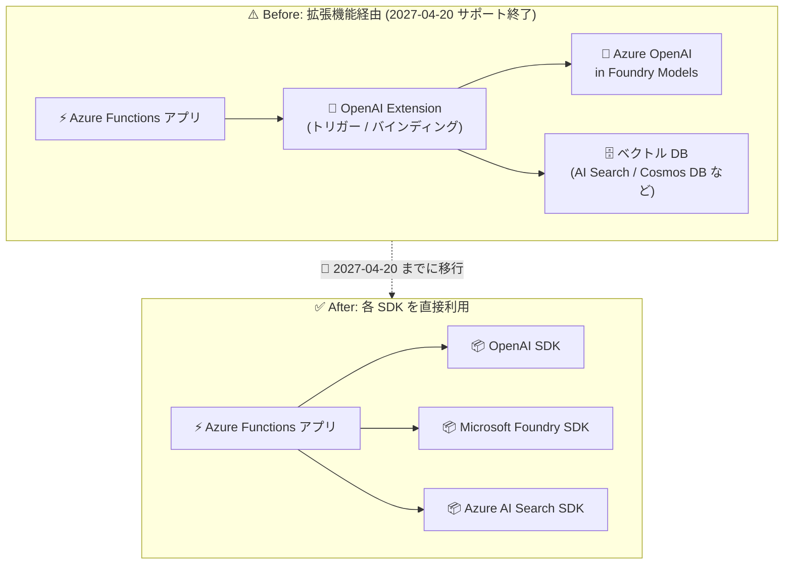

# Azure Functions: OpenAI Extension のサポート終了 (2027 年 4 月 20 日)

**リリース日**: 2026-11-20

**サービス**: Azure Functions

**機能**: Azure Functions OpenAI Extension のリタイアメント

**ステータス**: Retirement (アナウンス)

[このアップデートのインフォグラフィックを見る](https://takech9203.github.io/azure-news-summary/20261120-functions-openai-extension-retirement.html)

## 概要

Azure Functions OpenAI extension のサポートが **2027 年 4 月 20 日** に終了することがアナウンスされました。この拡張機能は、Azure OpenAI in Foundry Models の機能 (テキスト補完、アシスタント、埋め込み、セマンティック検索など) をトリガー / バインディングとして関数コードに簡単に統合できるものでしたが、今後はシナリオに応じて **OpenAI SDK、Microsoft Foundry SDK、Azure AI Search SDK** を直接利用する方式への移行が必要になります。

移行が完了するまでの間、.NET アプリは引き続き動作し、非 .NET アプリもプレビュー拡張機能バンドルのバージョン 4.60.0 より前 (`[4.*, 4.60.0)`) を使用するよう構成すれば動作を継続できます。ただし、プレビュー拡張機能バンドル 4.60.0 以降にはこの拡張機能が含まれておらず、古いバンドルへのピン留めや NuGet パッケージの継続利用によってサポート期限が延長されることはありません。2027 年 4 月 20 日以降はサポート対象外となり、セキュリティ更新、パッチ、テクニカルサポートは提供されなくなります。

**アップデート前 (現状)**

- Azure OpenAI の機能をトリガー / バインディングとして宣言的に利用でき、SDK 呼び出しコードを書かずに AI 機能を関数へ統合できた
- アシスタントの状態管理や埋め込みストアへの書き込みなどを拡張機能側が抽象化していた

**アップデート後 (リタイアメント後)**

- 2027 年 4 月 20 日以降、拡張機能はサポート対象外となり、セキュリティ更新・パッチ・テクニカルサポートが提供されない
- サポート外の拡張機能・ランタイム・言語バージョンでの実行は、問題発生やパフォーマンス低下につながる可能性がある
- シナリオに応じて OpenAI SDK、Microsoft Foundry SDK、Azure AI Search SDK を関数コードから直接呼び出す構成への移行が必要

## アーキテクチャ図



拡張機能のトリガー / バインディング経由で Azure OpenAI やベクトル DB にアクセスしていた構成から、関数コード内で各シナリオに対応する SDK (OpenAI / Microsoft Foundry / Azure AI Search) を直接呼び出す構成へ移行します。

## サービスアップデートの詳細

### 影響を受ける機能 (拡張機能が提供するトリガー / バインディング)

Azure Functions OpenAI extension は以下のトリガー / バインディングを提供しており、これらすべてがリタイアメントの対象です。

| 用途 | トリガー / バインディング |
|------|-------------------------|
| 標準テキストプロンプトによるコンテンツ補完 | Azure OpenAI text completion 入力バインディング |
| アシスタントからの関数呼び出し要求への応答 | Azure OpenAI assistant トリガー |
| アシスタントの作成 | Azure OpenAI assistant create 出力バインディング |
| アシスタントへのメッセージ送信 | Azure OpenAI assistant post 入力バインディング |
| アシスタント履歴の取得 | Azure OpenAI assistant query 入力バインディング |
| テキスト埋め込みの読み取り | Azure OpenAI embeddings 入力バインディング |
| ベクトルデータベースへの書き込み | Azure OpenAI embeddings store 出力バインディング |
| ベクトルデータベースからの読み取り (セマンティック検索) | Azure OpenAI semantic search 入力バインディング |

また、ベクトルデータベース連携用の以下の NuGet パッケージ群 (.NET) も拡張機能の一部です。

- Azure AI Search 連携: `Microsoft.Azure.Functions.Worker.Extensions.OpenAI.AzureAISearch` / `Microsoft.Azure.WebJobs.Extensions.OpenAI.AzureAISearch`
- Azure Cosmos DB 連携: `...OpenAI.CosmosDBSearch` / `...OpenAI.CosmosDBNoSQLSearch`
- Azure Data Explorer 連携: `...OpenAI.Kusto`

### 影響範囲

- **.NET アプリ**: `Microsoft.Azure.Functions.Worker.Extensions.OpenAI` (isolated worker) または `Microsoft.Azure.WebJobs.Extensions.OpenAI` (in-process) を利用しているアプリ。NuGet パッケージの直接利用で動作は継続するが、2027 年 4 月 20 日以降はサポート対象外
- **非 .NET アプリ (Java / JavaScript / TypeScript / PowerShell / Python)**: プレビュー拡張機能バンドル経由で拡張機能を利用しているアプリ。バンドル 4.60.0 以降には拡張機能が含まれないため、継続利用にはバージョン範囲 `[4.*, 4.60.0)` へのピン留めが必要。こちらも 2027 年 4 月 20 日以降はサポート対象外
- なお、Go はもともとこの機能に対応していない

### 移行パス

Microsoft は、シナリオに応じて以下の SDK を関数コードから直接利用する方式への移行を推奨しています。

1. **OpenAI SDK**: テキスト補完、アシスタント、埋め込みなど OpenAI / Azure OpenAI のモデル機能を直接呼び出すシナリオ
2. **Microsoft Foundry SDK**: Microsoft Foundry のモデル・エージェント機能を利用するシナリオ
3. **Azure AI Search SDK**: セマンティック検索やベクトル検索 (RAG) のシナリオ

移行後の認証・接続は、拡張機能のバインディング設定 (`AIConnectionName` や `AZURE_OPENAI_ENDPOINT` / `AZURE_OPENAI_KEY` など) ではなく、選択した SDK の認証・接続ガイダンスに従って構成します。

### タイムライン

| 日付 | イベント |
|------|---------|
| 2026-11-20 | リタイアメントのアナウンス (Microsoft Ignite に合わせて公開) |
| 現在〜2027-04-19 | 移行期間。.NET アプリは継続動作、非 .NET アプリはバンドル `[4.*, 4.60.0)` へのピン留めで継続動作 |
| **2027-04-20** | **サポート終了。** 以降はセキュリティ更新・パッチ・テクニカルサポートの提供なし |

## 設定方法 (移行完了までの暫定措置)

非 .NET アプリ (Java / JavaScript / TypeScript / PowerShell / Python) で拡張機能を継続利用する場合は、`host.json` で拡張機能バンドルのバージョン範囲を 4.60.0 未満に固定します。

```json
{
  "version": "2.0",
  "extensionBundle": {
    "id": "Microsoft.Azure.Functions.ExtensionBundle.Preview",
    "version": "[4.*, 4.60.0)"
  }
}
```

ただし、このピン留めはあくまで移行完了までの暫定措置であり、2027 年 4 月 20 日のサポート終了期限を延長するものではありません。

## デメリット・制約事項

- 拡張機能のトリガー / バインディングによる宣言的な AI 統合が利用できなくなり、SDK を直接呼び出すコードへの書き換えが必要
- 期限 (2027-04-20) 以降に移行せず利用を続けた場合、セキュリティ脆弱性への修正が提供されず、問題発生やパフォーマンス低下のリスクがある
- 古いバンドルへのピン留めや NuGet パッケージの継続利用では、サポート期限は延長されない

## 関連サービス・機能

- **Azure OpenAI in Foundry Models**: 拡張機能が統合していたモデル提供サービス。移行後は OpenAI SDK / Microsoft Foundry SDK で直接アクセスする
- **Azure AI Search**: セマンティック検索バインディングの移行先。Azure AI Search SDK を直接利用する
- **Azure Cosmos DB / Azure Data Explorer**: 拡張機能のベクトルストア連携パッケージが対象としていたデータストア。移行後は各サービスの SDK・API で連携する

## 参考リンク

- [インフォグラフィック](https://takech9203.github.io/azure-news-summary/20261120-functions-openai-extension-retirement.html)
- [公式アップデート情報](https://azure.microsoft.com/updates?id=579952)
- [Azure OpenAI extension for Azure Functions (Microsoft Learn)](https://learn.microsoft.com/azure/azure-functions/functions-bindings-openai)
- [Bundle for Azure Functions OpenAI Extension (Microsoft Learn)](https://learn.microsoft.com/azure/azure-functions/functions-bindings-openai?tabs=isolated-process%2Cai-connection-name&pivots=programming-language-java#install-bundle)

## まとめ

Azure Functions OpenAI extension は 2027 年 4 月 20 日にサポートが終了します。text completion、assistant、embeddings、semantic search の各トリガー / バインディングを利用しているすべての Functions アプリが対象です。Solutions Architect としては、まず拡張機能を利用しているアプリの棚卸しを行い、シナリオごとに OpenAI SDK、Microsoft Foundry SDK、Azure AI Search SDK のいずれへ移行するかを決定し、期限までに移行計画を実行することを推奨します。非 .NET アプリで当面の継続動作が必要な場合は、暫定措置として拡張機能バンドルを `[4.*, 4.60.0)` にピン留めしつつ、早期の移行を進めてください。

---

**タグ**: Azure Functions, Retirement, OpenAI, Microsoft Foundry, Azure AI Search, Compute, Containers, Internet of Things, Microsoft Ignite
