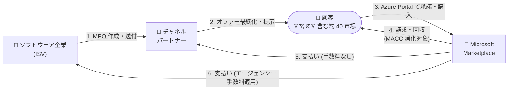

# Microsoft Marketplace: マルチパーティプライベートオファー (MPO) がマレーシアとサウジアラビアに拡大

**リリース日**: 2026-11-20

**サービス**: Microsoft Marketplace

**機能**: Multiparty private offers (MPO) の提供国拡大 (マレーシア・サウジアラビア)

**ステータス**: Announcement (Microsoft Ignite)

[このアップデートのインフォグラフィックを見る](https://takech9203.github.io/azure-news-summary/20261120-marketplace-mpo-malaysia-saudi-arabia.html)

## 概要

Microsoft Marketplace のマルチパーティプライベートオファー (Multiparty Private Offers、MPO) が、マレーシアとサウジアラビアに拡大されました。これにより、2026 年 11 月時点で MPO は約 40 の国・地域で利用可能になります。

MPO は、通常のプライベートオファーと同様にカスタム条件・価格を交渉できる仕組みですが、ソフトウェア企業 (ISV) が直接販売するのではなく、顧客が信頼するチャネルパートナー (リセラー) 経由で販売される点が特徴です。50 万以上のパートナーで構成されるエコシステムを通じた協調販売 (channel-led sales) を可能にし、顧客は既存のパートナーとの信頼関係を維持したまま、Marketplace 経由でシームレスにサードパーティのクラウド/AI ソリューションを調達できます。

**アップデート前の課題**

- マレーシアおよびサウジアラビアでは MPO が利用できず、チャネルパートナー経由の Marketplace 取引ができなかった

**アップデート後の改善**

- マレーシアとサウジアラビアの顧客 (課金アカウント) およびチャネルパートナー (税務プロファイル) が MPO の購入・販売に対応
- 両国の ISV・パートナー・顧客が、Marketplace 経由のチャネル販売モデルと MACC (Microsoft Azure Consumption Commitment) 消化のメリットを享受可能に

## アーキテクチャ図

ISV が作成した MPO をチャネルパートナーが最終化して顧客に提示し、顧客は Azure Portal で承諾後に Marketplace 経由で購入します。請求・支払いは Microsoft が仲介し、チャネルパートナーには手数料なし、ISV にはエージェンシー手数料を適用して支払われます。

## サービスアップデートの詳細

### 主要機能

1. **チャネルパートナー経由の Marketplace 取引**
   - MPO はプライベートオファーと同様に機能するが、顧客への販売はチャネルパートナーが行う
   - 顧客はカスタム条件・価格を交渉でき、Marketplace の簡素化された購入体験を利用できる

2. **MACC (クラウド消費コミットメント) への 100% カウント**
   - Co-sell 対象のソリューションを購入した場合、購入額全体が顧客の Azure クラウド消費コミットメントにカウントされる

3. **購入・販売フロー**
   - ソフトウェア企業 (または resale enabled offers の認定パートナー) が MPO を作成しチャネルパートナーへ送付
   - チャネルパートナーがオファーを最終化し顧客へ提示
   - 顧客は Azure Portal のプライベートオファー管理セクションで承諾し、Marketplace で各製品を購入
   - Microsoft が顧客へ請求・回収し、チャネルパートナー (手数料なし) と ISV (エージェンシー手数料適用) へ支払い

### 対応国・地域

- 顧客として購入するには、対応国・地域の課金アカウント ID が必要
- チャネルパートナーとして販売するには、対応国・地域の Partner Center 税務プロファイルの登録が必要
- 2026 年 11 月時点の対応市場 (約 40): 米国、英国、日本、オーストラリア、カナダ (顧客のみ)、香港、南アフリカ、欧州各国 (ドイツ、フランス、イタリア、スペイン、オランダ、北欧、中東欧ほか) に加え、今回 **マレーシア** と **サウジアラビア** が追加
- 米国のチャネルパートナーは再販証明書 (resale certificate) の提出が必要。カナダはチャネルパートナーの税務プロファイル対象外 (顧客としての購入のみ対応)

## メリット

### ビジネス面

- **顧客**: 信頼するチャネルパートナー経由で調達しつつ、Marketplace の一元的な請求と MACC 消化のメリットを享受できる
- **チャネルパートナー**: ISV と協業して独自オファーを構成し、提供ポートフォリオを拡大できる
- **ISV**: 既存の顧客関係を持つパートナーとの協業により、マレーシア・サウジアラビアを含む新市場へ迅速に展開できる

### 市場動向

- Omdia の推計では、2030 年までに Microsoft Marketplace 上のクラウドビジネスの 60% がチャネル主導の販売に依存すると見込まれている

## デメリット・制約事項

- MACC へのカウントは co-sell 対象 (co-sell eligible) のソリューション購入に限られる
- 顧客・チャネルパートナーともに対応国・地域の要件 (課金アカウント / 税務プロファイル) を満たす必要がある

## 関連サービス・機能

- **プライベートオファー (ISV-to-customer)**: ISV が顧客へ直接販売する形態。MPO はこれをチャネルパートナー経由に拡張したもの
- **MACC (Microsoft Azure Consumption Commitment)**: co-sell 対象の MPO 購入は 100% がコミットメント消化にカウントされる
- **Resale enabled offers**: 認定パートナーが ISV に代わって MPO を作成できる仕組み

## 参考リンク

- [インフォグラフィック](https://takech9203.github.io/azure-news-summary/20261120-marketplace-mpo-malaysia-saudi-arabia.html)
- [公式アップデート情報](https://azure.microsoft.com/updates?id=580700)
- [Multiparty private offers overview (Microsoft Learn)](https://learn.microsoft.com/en-us/partner-center/marketplace-offers/multiparty-private-offers-overview)
- [Private offers overview (Microsoft Learn)](https://learn.microsoft.com/en-us/marketplace/private-offers-overview)

## まとめ

MPO のマレーシア・サウジアラビアへの拡大により、両国の顧客はチャネルパートナー経由で Marketplace のサードパーティクラウド/AI ソリューションを調達できるようになり、対応市場は約 40 に拡大しました。該当地域で事業を展開する ISV・チャネルパートナーは、Partner Center での税務プロファイル登録や co-sell 対象化を確認し、MACC 消化を活用した提案を検討することを推奨します。

---

**タグ**: Microsoft Marketplace, Multiparty Private Offers, MPO, Channel Partner, MACC, Microsoft Ignite, Malaysia, Saudi Arabia
